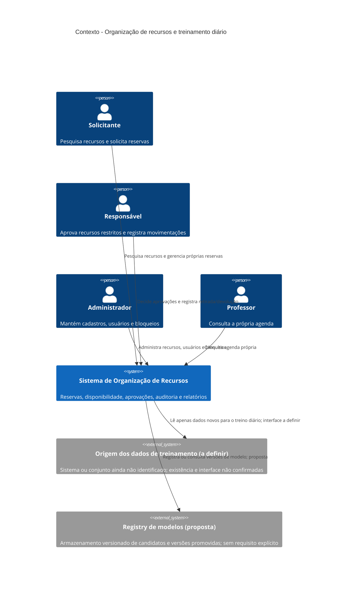
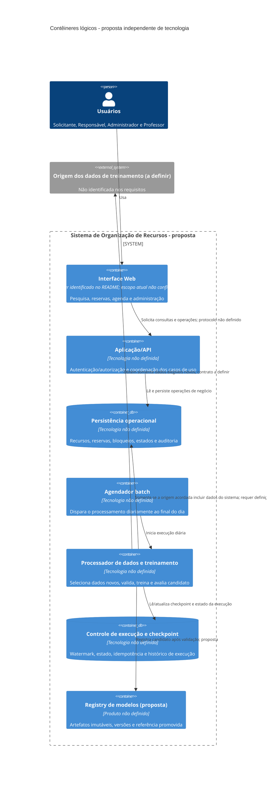
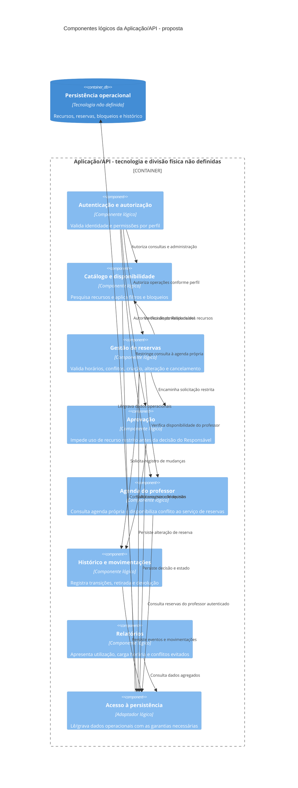
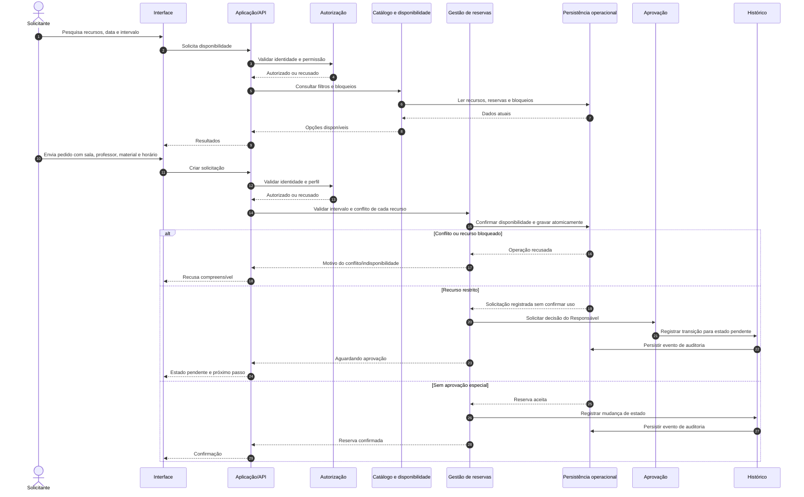

# Arquitetura de software

## Seção inicial: contexto e drivers arquiteturais

Esta seção registra o contexto conhecido e os fatores que devem orientar decisões futuras. Ela não substitui nem altera os requisitos existentes. Quando uma informação não está documentada, ela é identificada como lacuna ou pergunta aberta, em vez de ser tratada como decisão.

## Contexto e objetivo

### Fatos documentados

- O sistema deve organizar reservas de salas, professores e materiais sem conflitos de horário. Fonte: [requisitos-funcionais.md](requisitos-funcionais.md), introdução.
- O fluxo inclui pesquisa de recursos, criação e manutenção de reservas, aprovação de recursos restritos, bloqueios de manutenção, movimentação de materiais, histórico e relatórios. Fontes: [requisitos-funcionais.md](requisitos-funcionais.md), RF-02 a RF-14.
- O sistema deve impedir horários inválidos, sobreposição de reservas e dupla alocação em solicitações simultâneas. Fontes: [requisitos-funcionais.md](requisitos-funcionais.md), RF-05 e RF-06; [requisitos-nao-funcionais.md](requisitos-nao-funcionais.md), RNF-02.
- O projeto define metas para segurança, persistência, usabilidade, cobertura de testes, rastreabilidade e integração contínua. Fonte: [requisitos-nao-funcionais.md](requisitos-nao-funcionais.md), RNF-03 a RNF-09.
- O README documenta um projeto criado com Angular CLI 21.2.8 e os comandos de desenvolvimento, build e teste. Fonte: [README.md](../README.md).
- **Restrição obrigatória desta arquitetura:** existe um cron job executado diariamente ao final do dia para treinar ou retreinar usando somente dados novos. Origem: instrução explícita desta solicitação; esse requisito ainda não consta nos documentos de requisitos do repositório.

### Objetivo

Oferecer uma aplicação que permita organizar recursos e reservas com controle de acesso, prevenção de conflitos, registro de alterações e evidências verificáveis de qualidade. Também deve respeitar a execução diária do cron job de treinamento ou retreinamento, limitado a dados novos. Fontes: [requisitos-funcionais.md](requisitos-funcionais.md), introdução e RF-01 a RF-14; [requisitos-nao-funcionais.md](requisitos-nao-funcionais.md), RNF-01 a RNF-09; restrição do cron job informada nesta solicitação.

## Stakeholders e personas

As únicas personas documentadas no repositório são:

- **Solicitante:** pesquisa recursos e cria, altera ou cancela suas próprias reservas. Fonte: [persona-1-solicitante.md](personas/persona-1-solicitante.md).
- **Responsável:** analisa solicitações de recursos restritos e registra retirada e devolução de materiais. Fonte: [persona-2-responsavel.md](personas/persona-2-responsavel.md).
- **Administrador:** mantém cadastros, usuários, bloqueios de manutenção e consulta relatórios. Fonte: [persona-3-administrador.md](personas/persona-3-administrador.md).
- **Professor:** consulta a própria agenda e deve ser considerado na prevenção de conflitos. Fonte: [persona-4-professor.md](personas/persona-4-professor.md).

Não há outros stakeholders identificados nos documentos do repositório. As personas usam nomes fictícios, conforme declarado em seus arquivos; os nomes não definem usuários reais.

## Requisitos arquiteturalmente significativos

- **Acesso e autorização por perfil:** as funções devem respeitar os perfis Solicitante, Responsável, Administrador e Professor. Fontes: [requisitos-funcionais.md](requisitos-funcionais.md), RF-01 e RF-14; [requisitos-nao-funcionais.md](requisitos-nao-funcionais.md), RNF-03.
- **Consistência de agenda:** horários finais devem ser posteriores aos iniciais; a mesma sala, professor ou material não pode ter reservas sobrepostas; reservas consecutivas são permitidas. Fonte: [requisitos-funcionais.md](requisitos-funcionais.md), RF-05 e “Regras simples”.
- **Concorrência:** duas solicitações simultâneas para o mesmo recurso e horário não podem resultar em duas reservas aceitas; o teste especificado espera exatamente uma aceita. Fontes: [requisitos-funcionais.md](requisitos-funcionais.md), RF-06; [requisitos-nao-funcionais.md](requisitos-nao-funcionais.md), RNF-02.
- **Aprovação e disponibilidade:** recurso restrito exige aprovação do Responsável; recurso em manutenção ou indisponível não pode ser reservado no período bloqueado. Fonte: [requisitos-funcionais.md](requisitos-funcionais.md), RF-07 e RF-08.
- **Histórico e movimentação de materiais:** mudanças de estado registram usuário, data e estados anterior e novo; reservas em uso não podem ser apagadas; retirada e devolução guardam material, reserva, data, hora e usuário. Fonte: [requisitos-funcionais.md](requisitos-funcionais.md), RF-09 e RF-10.
- **Persistência:** reservas e histórico confirmados devem permanecer após reinício do serviço. Fonte: [requisitos-nao-funcionais.md](requisitos-nao-funcionais.md), RNF-04.
- **Relatórios e evidências:** o sistema apresenta utilização, carga horária e conflitos evitados; requisitos críticos devem estar relacionados a risco, teste e evidência na RTM. Fontes: [requisitos-funcionais.md](requisitos-funcionais.md), RF-12; [requisitos-nao-funcionais.md](requisitos-nao-funcionais.md), RNF-08.
- **Treinamento agendado:** há execução diária ao final do dia para treinar ou retreinar usando somente dados novos. Origem: instrução explícita desta solicitação. Frequência e restrição de dados são conhecidas; tecnologia, definição de “dados novos”, resultado do treinamento e comportamento em falha ainda não estão especificados.

## Atributos de qualidade

- **Desempenho:** até 50 usuários simultâneos; 95% das pesquisas de disponibilidade em até 2 segundos e 95% das demais operações comuns em até 3 segundos. Evidência exigida: teste de carga com JMeter. Fonte: [requisitos-nao-funcionais.md](requisitos-nao-funcionais.md), RNF-01.
- **Consistência sob concorrência:** exatamente uma solicitação aceita no teste de duas solicitações conflitantes para o mesmo recurso e horário. Evidência exigida: teste automatizado de integração. Fonte: [requisitos-nao-funcionais.md](requisitos-nao-funcionais.md), RNF-02.
- **Segurança:** 100% dos testes de acesso por perfil aprovados; nenhuma vulnerabilidade crítica ou alta aberta na entrega; dados validados e mensagens sem detalhes internos. Fonte: [requisitos-nao-funcionais.md](requisitos-nao-funcionais.md), RNF-03.
- **Confiabilidade e persistência:** nenhum dado confirmado de reserva ou histórico perdido após reinício. Fonte: [requisitos-nao-funcionais.md](requisitos-nao-funcionais.md), RNF-04.
- **Usabilidade e adaptação de tela:** pesquisa, reserva e cancelamento devem ser testados em larguras de 360 px e 1280 px; mensagens devem explicar o problema. Fonte: [requisitos-nao-funcionais.md](requisitos-nao-funcionais.md), RNF-05.
- **Testabilidade e qualidade:** cobertura mínima de 80% das linhas e 70% dos branches; zero bugs críticos e zero vulnerabilidades críticas abertas; build e testes executados em cada pull request. Fontes: [requisitos-nao-funcionais.md](requisitos-nao-funcionais.md), RNF-06, RNF-07 e RNF-09.
- **Rastreabilidade:** 100% dos requisitos críticos registrados na RTM com risco, teste e evidência. Fonte: [requisitos-nao-funcionais.md](requisitos-nao-funcionais.md), RNF-08.
- **Agenda sem conflitos:** reservas de sala, professor ou material não podem se sobrepor; recursos bloqueados não podem ser selecionados durante o bloqueio. Fonte: [requisitos-funcionais.md](requisitos-funcionais.md), RF-05 e RF-08.
- **Processamento diário de dados novos:** o treinamento ou retreinamento ocorre diariamente ao final do dia e usa somente dados novos. Origem: instrução explícita desta solicitação; critérios operacionais adicionais não foram documentados.

## Drivers priorizados

A prioridade abaixo é uma classificação arquitetural inicial, baseada na criticidade e nas metas declaradas. Ela não cria novos requisitos nem altera a prioridade formal dos requisitos existentes.

- **P0 — Impedir alocações conflitantes e duplicadas.** A reserva só pode ser aceita quando horário, sala, professor e materiais não conflitam, inclusive diante de pedidos simultâneos. Origem: [requisitos-funcionais.md](requisitos-funcionais.md), RF-05 e RF-06; [requisitos-nao-funcionais.md](requisitos-nao-funcionais.md), RNF-02.
- **P0 — Proteger operações por perfil.** Toda função protegida deve exigir autenticação e autorização correta, sem expor dados internos em erros. Origem: [requisitos-funcionais.md](requisitos-funcionais.md), RF-01; [requisitos-nao-funcionais.md](requisitos-nao-funcionais.md), RNF-03.
- **P0 — Respeitar a restrição do cron job.** O job deve executar diariamente ao final do dia e treinar ou retreinar somente com dados novos. Origem: instrução explícita desta solicitação; ainda sem identificador nos requisitos do repositório.
- **P1 — Preservar dados e histórico auditável.** Reservas e histórico devem sobreviver a reinícios e registrar as mudanças e movimentações especificadas. Origem: [requisitos-funcionais.md](requisitos-funcionais.md), RF-09 e RF-10; [requisitos-nao-funcionais.md](requisitos-nao-funcionais.md), RNF-04.
- **P1 — Cumprir os limites de desempenho.** Atender aos percentis, tempos e carga simultânea definidos para pesquisas e operações comuns. Origem: [requisitos-nao-funcionais.md](requisitos-nao-funcionais.md), RNF-01.
- **P1 — Demonstrar qualidade e rastreabilidade.** Produzir cobertura, análise, testes por pull request e evidências associadas aos requisitos críticos. Origem: [requisitos-nao-funcionais.md](requisitos-nao-funcionais.md), RNF-06 a RNF-09.
- **P2 — Permitir uso compreensível em telas diferentes.** Pesquisa, reserva e cancelamento devem funcionar nas larguras especificadas, com mensagens claras. Origem: [requisitos-funcionais.md](requisitos-funcionais.md), RF-11 e RF-13; [requisitos-nao-funcionais.md](requisitos-nao-funcionais.md), RNF-05.
- **P2 — Apoiar administração e acompanhamento.** Manter recursos, bloqueios, agenda do professor e relatórios de utilização. Origem: [requisitos-funcionais.md](requisitos-funcionais.md), RF-02, RF-08, RF-12 e RF-14.

## Glossário

- **Recurso:** sala, professor, material ou equipamento que pode estar associado a uma reserva. Fonte: [requisitos-funcionais.md](requisitos-funcionais.md), introdução e RF-02 a RF-09.
- **Reserva:** solicitação que associa recursos a uma data e a horários. Fonte: [requisitos-funcionais.md](requisitos-funcionais.md), RF-04 e RF-05.
- **Conflito de horário:** sobreposição entre reservas do mesmo recurso; horários consecutivos são permitidos. Fonte: [requisitos-funcionais.md](requisitos-funcionais.md), RF-05.
- **Recurso restrito:** recurso cuja reserva exige aprovação do Responsável. Fonte: [requisitos-funcionais.md](requisitos-funcionais.md), RF-07.
- **Bloqueio:** período de manutenção ou indisponibilidade no qual um recurso não pode ser reservado. Fonte: [requisitos-funcionais.md](requisitos-funcionais.md), RF-08.
- **Histórico:** registro de mudanças de estado com usuário, data e estado anterior e novo. Fonte: [requisitos-funcionais.md](requisitos-funcionais.md), RF-10.
- **RTM:** matriz de rastreabilidade de requisitos; neste projeto, deve ligar requisitos críticos a riscos, testes e evidências. Fonte: [requisitos-nao-funcionais.md](requisitos-nao-funcionais.md), RNF-08.
- **Cron job:** tarefa agendada mencionada nesta solicitação, executada diariamente ao final do dia para treinamento ou retreinamento com dados novos. A tecnologia e a definição operacional de “dados novos” não foram especificadas.

## Fatos, lacunas, conflitos e suposições

### Fatos

- Os requisitos funcionais e não funcionais e as quatro personas estão documentados nos caminhos citados nesta seção.
- O projeto deve organizar reservas sem conflitos, aplicar perfis de acesso e produzir evidências mensuráveis de qualidade.
- Existe a restrição do cron job diário ao final do dia, com uso somente de dados novos; ela foi informada nesta solicitação, não nos arquivos de requisitos existentes.
- O README identifica o projeto como criado com Angular CLI 21.2.8. Isso descreve o esqueleto documentado, mas não confirma toda a arquitetura ou os serviços de produção.

### Lacunas

- Não há documento de decisões arquiteturais anteriores (ADR) encontrado na documentação lida.
- Não estão definidos os dados de entrada do treinamento, a origem dos dados, o armazenamento, a regra para identificar dados novos, o produto do treinamento, como avaliar esse produto ou o comportamento em falha.
- Não estão definidos fuso horário, horário exato do fim do dia, política de repetição do cron job, prevenção de execução duplicada ou tratamento de uma execução que ultrapasse a próxima janela.
- Não há definição completa dos estados e transições da reserva, nem do significado exato de “aceita” em RF-06 quando uma reserva aguarda aprovação.
- Não estão definidos tipos, limites, formatos nem retenção dos dados pessoais ou dos registros de auditoria.
- Não está especificado o escopo do teste de carga além de até 50 usuários simultâneos e os limites de resposta registrados em RNF-01.

### Conflitos ou inconsistências documentais

- RNF-06 solicita relatório JaCoCo, enquanto o README descreve um projeto gerado com Angular CLI 21.2.8. Os documentos não explicam a relação entre essa ferramenta de cobertura e a aplicação atual; não se presume uma solução.
- RF-01 cita os quatro perfis, mas não define as operações permitidas em detalhe. As personas descrevem permissões adicionais; por exemplo, a persona Administrador administra usuários e perfis, mas RF-02 trata explicitamente apenas do cadastro de recursos.
- RF-06 e RNF-02 usam o resultado “aceita”, mas os documentos não definem se uma solicitação pendente de aprovação conta como aceita para esse teste.
- RNF-07 menciona zero bugs críticos e zero vulnerabilidades críticas, enquanto RNF-03 exige zero vulnerabilidades críticas ou altas. As duas condições devem ser preservadas; os documentos não explicam como classificar ou consolidar os resultados.

### Suposições de análise

- A prioridade P0/P1/P2 desta seção é uma ordenação para orientar análise e não uma prioridade aprovada pelo usuário ou existente nos requisitos.
- A restrição do cron job é tratada como driver arquitetural obrigatório porque foi explicitamente exigida nesta solicitação; não se presume sua tecnologia nem a natureza dos dados.
- Os nomes nas personas são tratados como nomes fictícios, pois os arquivos os identificam dessa forma.

### Perguntas abertas

- O que conta como “dados novos”: registros criados desde a última execução, ainda não processados, ou outro critério?
- Qual é a origem, o formato e o responsável pelos dados de treinamento? Existem dados pessoais ou restrições de acesso que devem ser consideradas?
- Qual é o horário e o fuso de “final do dia”? Qual comportamento é esperado se não houver dados novos ou se a execução falhar?
- O resultado do treinamento deve ser armazenado, validado, aprovado ou disponibilizado de que forma? Há critérios de qualidade para esse resultado?
- A persona Professor representa um perfil autenticável distinto ou um cadastro de professor que apenas consulta uma agenda?
- O Administrador pode gerenciar usuários e perfis como descrito na persona? Quais operações específicas são permitidas a cada perfil?
- Uma solicitação pendente de aprovação é considerada “aceita” para RF-06/RNF-02? Em que momento a reserva bloqueia o recurso?
- Como a meta JaCoCo de RNF-06 deve ser aplicada ao projeto descrito no README?
- Qual nível de auditoria e período de retenção são esperados para reservas, aprovações, retiradas e devoluções?

## Riscos iniciais

- **Dupla alocação por concorrência:** pedidos simultâneos podem comprometer a regra de reserva única se a validação e a confirmação não forem coordenadas. Relacionado a RF-05, RF-06 e RNF-02.
- **Acesso indevido:** permissões descritas de forma incompleta podem permitir ações não autorizadas ou bloquear ações legítimas. Relacionado a RF-01, RF-07, RF-09 e RNF-03.
- **Perda de dados ou histórico:** falhas de persistência podem apagar reservas confirmadas ou reduzir a rastreabilidade. Relacionado a RF-10 e RNF-04.
- **Treinamento com dados repetidos ou dados inadequados:** sem definição operacional de “dados novos”, o cron job pode reprocessar registros ou usar um conjunto diferente do esperado. Relacionado à restrição explícita do cron job; detalhes ainda são pergunta aberta.
- **Execução diária ausente, duplicada ou incompleta:** a janela, a política de repetição e a recuperação de falhas não estão especificadas. Relacionado à restrição explícita do cron job.
- **Metas de qualidade sem evidência reproduzível:** ambiente, dados e configuração de alguns testes não estão suficientemente definidos; isso pode dificultar a comprovação das metas. Relacionado a RNF-01, RNF-05 a RNF-09.
- **Cobertura incompatível com a ferramenta documentada:** a exigência de JaCoCo pode não corresponder ao esqueleto Angular descrito no README, deixando a métrica sem forma acordada de comprovação. Relacionado a RNF-06 e [README.md](../README.md).
- **Relatórios divergentes da operação real:** ausência de definição para contabilizar “conflitos evitados” pode produzir interpretações distintas do relatório. Relacionado a RF-12.

## Responsabilidades, limites e interfaces

### Estado desta proposta

- Os requisitos funcionais não definem uma arquitetura interna, uma API, um banco, um serviço de treinamento ou um registry de modelos.
- Os diagramas abaixo descrevem uma **arquitetura lógica proposta**, não afirmam que esses componentes já existam ou que tenham tecnologias escolhidas.
- Os limites de responsabilidade são propostas derivadas dos requisitos indicados em cada item. Pontos marcados como **sem requisito** são sugestões para avaliação, não obrigações aprovadas.
- A única tecnologia identificada nos documentos é Angular CLI 21.2.8 no README. Isso não comprova que a aplicação esteja completa nem define a tecnologia de backend, persistência, agendamento ou ML.

### Limites de sistema

- **Aplicação de organização de recursos:** autentica usuários, expõe as funções do sistema, coordena regras de reservas e apresenta resultados. Derivado de RF-01 a RF-14 e RNF-03.
- **Persistência operacional:** guarda cadastros, reservas, estados, bloqueios, movimentações e registros necessários aos relatórios. A necessidade de persistir reservas e histórico é requisito; o produto e o desenho físico são **sem requisito**. Fontes: RF-02, RF-08 a RF-10, RF-12 e RNF-04.
- **Treinamento batch:** processo agendado diariamente ao final do dia, limitado a dados novos. A execução é restrição explícita desta solicitação; se treina um modelo, quais dados usa e como publica seu resultado ainda são lacunas.
- **Origem de dados batch:** sistema ou conjunto que fornece os dados elegíveis para treinamento. Sua existência como integração separada, formato, propriedade e interface são **sem requisito** e precisam ser definidos.
- **Consumidor de eventual resultado ML:** não há requisito dizendo que reservas ou decisões online usem um modelo. Não se presume inferência online nem que o treinamento altere o comportamento de reserva.
- **Identidade, armazenamento de artefatos, monitoramento e alertas:** dependências possíveis para a proposta batch. Produtos e integrações específicos são **sem requisito**.

### Responsabilidades lógicas

- **Interface de usuário:** oferece pesquisa, operação de reserva, acompanhamento, agenda e funções administrativas conforme o perfil. Derivado de RF-01 a RF-04, RF-11, RF-13 e RF-14; RNF-05.
- **Fachada de aplicação/API:** valida a identidade e autorização de cada operação, valida dados de entrada e coordena as operações de negócio sem expor detalhes internos. Derivado de RF-01 e RNF-03. O protocolo e o formato da API são **sem requisito**.
- **Catálogo e disponibilidade:** mantém ou consulta salas, professores e materiais, filtros e bloqueios. Derivado de RF-02, RF-03 e RF-08.
- **Serviço de reservas:** valida intervalo, verifica conflito de sala, professor e material, aplica a atomicidade necessária na confirmação e coordena criação, alteração e cancelamento. Derivado de RF-04 a RF-06 e RNF-02.
- **Fluxo de aprovação:** aplica a exigência de aprovação para recursos restritos e guarda a decisão do Responsável. Derivado de RF-07 e RF-10.
- **Agenda do professor:** apresenta ao Professor apenas sua própria agenda e participa da validação de conflito de docente. Derivado de RF-05 e RF-14.
- **Auditoria e movimentação:** registra transições de estado, retirada e devolução com os dados exigidos. Derivado de RF-09 e RF-10; RNF-04 e RNF-08.
- **Relatórios:** agrega utilização, carga horária e conflitos evitados por período e recurso. Derivado de RF-12. Definições de cálculo são **sem requisito**.
- **Orquestração do batch:** inicia a execução diária, evita execuções concorrentes, controla checkpoint, tentativa e estado do processamento. Agendamento diário é restrição explícita; mecanismo e política de retry são **sem requisito**.
- **Preparação de dados:** seleciona somente dados novos conforme um critério ainda a definir, valida esquema e qualidade, produz conjunto rastreável e evita incluir itens já consumidos. A exigência “somente dados novos” é explícita nesta solicitação; mecanismo, critérios e limiares são **sem requisito**.
- **Treinador e validador:** executa o treino/retreino e compara o candidato com critérios de qualidade que ainda precisam ser acordados. Treinar/retreinar é parte da restrição informada; algoritmo, métricas e critérios de aceite são **sem requisito**.
- **Gestão de modelos:** guarda versões imutáveis e metadados; promove um candidato somente depois da validação acordada e permite retornar a uma versão anterior. Essas práticas são propostas de governança, **sem requisito explícito**.

### Interfaces e contratos lógicos

As interfaces abaixo são contratos conceituais; não determinam rotas HTTP, protocolo, formato serializado ou tecnologia.

- **Usuário → Interface:** envia credenciais e comandos de consulta/alteração; recebe dados permitidos e confirmação ou motivo compreensível. Derivado de RF-01, RF-03, RF-04, RF-11, RF-13 e RF-14.
- **Interface → Aplicação:** apresenta identidade da sessão, operação e dados solicitados; a aplicação retorna resultado autorizado, validação ou conflito. Protocolo **sem requisito**. Derivado de RF-01, RF-04 e RNF-03.
- **Aplicação → Catálogo:** consulta recursos, atributos, disponibilidade e bloqueios; mantém cadastros quando autorizado. Derivado de RF-02, RF-03 e RF-08.
- **Aplicação → Serviço de reservas:** envia recursos, data e intervalo; recebe reserva criada/alterada/cancelada ou rejeição explicando conflito, indisponibilidade, autorização ou aprovação pendente. Derivado de RF-04 a RF-08 e RF-11.
- **Aplicação → Persistência operacional:** grava e lê cadastros, reservas, transições e movimentações de forma que uma operação confirmada sobreviva à reinicialização. Atomicidade para conflitos deriva de RF-06/RNF-02; tecnologia **sem requisito**.
- **Aplicação → Auditoria:** envia ator, instante, entidade, estado anterior e novo; o registro deve ser associado à operação relevante. Campos de estado são derivados de RF-09/RF-10; correlação técnica adicional é proposta, **sem requisito**.
- **Orquestrador batch → Fonte de dados:** solicita ou lê itens elegíveis após o checkpoint e recebe dados com identificador ou ordenação suficiente para deduplicação. Interface e identificadores são **sem requisito** e dependem da fonte real.
- **Orquestrador → Preparação/Treinador/Validador:** envia referência ao recorte de dados e configuração versionada; recebe estado da execução, validações e referência ao artefato candidato. Contrato e formato são **sem requisito**.
- **Validador → Registry de modelos:** registra candidato validado com versão e metadados; promoção altera uma referência ativa sem sobrescrever versões anteriores. Registry e promoção automática ou manual são **sem requisito**.
- **Aplicação online → Modelo:** não há interface aprovada. Alternativas: não servir inferência; inferência síncrona fora do caminho crítico; ou inferência assíncrona. Escolher qualquer uma exige requisito de negócio/latência e dados de entrada; RNF-01 é para pesquisa e operações comuns, não especifica inferência.

## Diagramas de arquitetura lógica

Os diagramas Mermaid usam a sintaxe C4. Caixas marcadas “proposta” são limites lógicos a validar, não tecnologias confirmadas.

### C4: contexto



### C4: contêineres lógicos



O relacionamento do batch com a persistência operacional é condicional: os requisitos não identificam de onde vêm os dados novos. A linha tracejada semântica não está disponível na sintaxe usada; o rótulo deixa explícito que não é uma integração decidida.

### C4: componentes da aplicação/API



Os componentes são fronteiras de responsabilidade propostas; RF/RNF não exigem deploy separado, microserviços ou uma tecnologia específica. A persistência de conflito precisa ser atômica no ponto de confirmação, mas o mecanismo físico permanece em aberto.

## Sequências de interação

### Fluxo online: consultar e solicitar uma reserva



Este fluxo deriva de RF-01, RF-03 a RF-08, RF-10 e RF-11, e RNF-02/RNF-03. O diagrama usa “sem confirmar uso” para expressar RF-07, mas os estados exatos da solicitação pendente não estão definidos. O ponto e a forma da atomicidade não escolhem mecanismo de banco.

### Fluxo batch: treinamento/retreinamento diário com dados novos

```mermaid
sequenceDiagram
	autonumber
	participant S as Agendador diário
	participant O as Orquestrador batch
	participant C as Checkpoint/ledger
	participant F as Fonte de dados (a definir)
	participant Q as Validação e preparação
	participant T as Treinador
	participant V as Validador do candidato
	participant R as Registry (proposta)
	participant M as Monitoramento

	S->>O: Disparo diário ao final do dia
	O->>C: Adquirir lock e ler watermark/checkpoint
	alt Execução concorrente já ativa
		C-->>O: Lock ocupado
		O->>M: Registrar execução ignorada/concorrente
	else Lock adquirido
		C-->>O: Último checkpoint confirmado
		O->>F: Solicitar somente dados posteriores/elegíveis ao checkpoint
		F-->>O: Dados candidatos e identificadores/versões disponíveis
		O->>Q: Validar esquema, duplicatas, qualidade e elegibilidade
		alt Sem dados novos ou validação falhou
			Q-->>O: Nenhum dado elegível ou falha com motivo
			O->>M: Registrar resultado sem treino ou falha
			O->>C: Manter checkpoint confirmado; liberar lock
		else Dados novos válidos
			Q-->>O: Recorte de dados e metadados de linhagem
			O->>T: Treinar/retreinar com recorte e configuração identificados
			T-->>O: Candidato, métricas e metadados de execução
			O->>V: Validar candidato contra critérios aprovados
			alt Critérios falham ou validação inconclusiva
				V-->>O: Candidato rejeitado/não promovível
				O->>M: Registrar falha, métricas e referência do candidato
				O->>C: Não avançar checkpoint; liberar lock
			else Critérios aprovados
				V-->>O: Candidato aprovado
				O->>R: Registrar versão imutável e metadados
				R-->>O: Identificador da versão registrada
				opt Promoção autorizada conforme política a definir
					O->>R: Atualizar referência ativa sem sobrescrever versões
					R-->>O: Promoção concluída
				end
				O->>C: Confirmar dados processados e avançar checkpoint
				O->>M: Registrar sucesso, duração, recorte e versão
				O->>C: Liberar lock
			end
		end
	end
```

O fluxo representa uma proposta de segurança operacional, não um requisito completo de ML. A sequência intencionalmente separa “registrar candidato” de “promover”: os requisitos não autorizam promoção automática. O checkpoint deve avançar somente depois do estágio que a organização decidir considerar como processamento concluído; o estágio exato depende de decisão de produto/governança.

## Análise do processamento batch de ML

### Watermark e checkpoint

- **Necessidade:** distinguir dados novos de dados já processados é indispensável para satisfazer a restrição de usar somente dados novos. Origem: restrição explícita desta solicitação; risco já registrado em “Riscos iniciais”.
- **Proposta inicial:** persistir por fonte um watermark confirmado e um ledger de execução que associe intervalo/identificadores de entrada ao resultado. Atualizar o watermark de forma transacional após o estágio definido como concluído. Isso reduz reprocessamento e perda de dados; é uma decisão operacional proposta, **sem requisito que defina formato, granularidade ou commit point**.
- **Alternativas:** offset/sequence monotônico fornecido pela fonte; cursor por versão; ou par `(updated_at, stable_id)` se a fonte não oferecer sequência. Timestamp sozinho pode perder registros com horários iguais, atrasos ou relógios inconsistentes.
- **Dados atrasados:** definir se um registro que chega tarde com timestamp antigo ainda é “novo”. Alternativas: usar sequência de ingestão da fonte; varredura com janela de atraso mais deduplicação; ou rejeitar atrasos. A janela e a definição de novidade são **sem requisito**.
- **Confirmação:** não avançar checkpoint em falha de leitura, validação, treino ou gravação do artefato. Se a política disser que dados válidos são “processados” mesmo quando o modelo é rejeitado, isso pode permitir checkpoint após validação e persistência de evidência; ainda é **pergunta aberta**, pois “treinar usando dados novos” não define a conclusão do processamento.

### Idempotência

- **Proposta inicial:** cada execução ter uma chave determinística derivada da origem, recorte de dados, versão do pipeline e configuração; registrar estados como iniciada, concluída ou falha. Repetir a mesma chave não deve criar um segundo artefato lógico nem avançar watermark duas vezes.
- **Justificativa:** cron pode repetir disparos ou ser reiniciado; idempotência reduz artefatos duplicados e se alinha à confiabilidade de RNF-04. O cron/ML não tem requisito de idempotência próprio; mecanismo e retenção do ledger são **sem requisito**.
- **Alternativas:** ledger transacional na persistência disponível; controle de execução no orquestrador; ou chave única na camada de metadados do artefato. Escolha depende da infraestrutura aprovada.
- **Não confundir:** deduplicar a execução não deve remover do conjunto novos registros distintos; a chave de registro e a regra de identidade da fonte precisam ser definidas.

### Lock e concorrência

- **Proposta inicial:** permitir no máximo uma execução ativa por fonte e pipeline. Adquirir lock com lease ou mecanismo equivalente, registrar proprietário e expiração e usar fencing/versionamento para impedir que um processo antigo grave checkpoint após perder o lock.
- **Justificativa:** evita corrida entre cron duplicado, reinício ou múltiplas instâncias. Não existe requisito de implantação multi-instância nem de mecanismo de lock; essa decisão é **sem requisito**, proposta para integridade.
- **Alternativas:** lock na base persistente; lock distribuído do orquestrador; ou restrição de instância única administrada pela plataforma. A última é mais simples, mas só é válida se a topologia garantir exclusividade.
- **Pergunta aberta:** um segundo disparo deve ser ignorado, enfileirado ou aguardar? Não há política requerida.

### Retry e recuperação

- **Proposta inicial:** classificar falhas como transitórias ou permanentes; repetir falhas transitórias com limite e atraso crescente; não repetir cegamente erros de esquema ou qualidade. Preservar estado, chave idempotente, watermark anterior e logs/metadados para retomada.
- **Justificativa:** confiabilidade e ausência de perda de dados confirmados são RNF-04; os detalhes do batch não têm SLA de recuperação nem política de tentativa, portanto limites e atrasos são **sem requisito**.
- **Recuperação segura:** artefato candidato incompleto não é promovido; checkpoint não confirmado permanece inalterado; nova tentativa reutiliza o mesmo recorte, salvo se a definição de dados novos mudar explicitamente.
- **Alternativas:** repetir a execução inteira; retomar por etapas com artefatos intermediários imutáveis; ou encaminhar falha permanente para intervenção. Retomada por etapas economiza custo, mas requer versionamento de cada etapa.
- **Perguntas abertas:** duração máxima, número de tentativas, alertas, janela de recuperação, responsabilidade operacional e tratamento de uma execução que cruza o próximo fim de dia.

### Qualidade dos dados e linhagem

- **Proposta inicial:** antes de treinar, validar esquema, campos obrigatórios, tipos, duplicatas, intervalo temporal e quantidade mínima/máxima acordada. Registrar contagens de entrada, rejeições, versão do esquema, origem e identificadores/intervalo processado.
- **Justificativa:** a restrição exige seleção de dados novos; RNF-03 exige validar entradas no sistema, e RNF-08 requer rastreabilidade entre requisito, risco, teste e evidência. Aplicar essas garantias ao dataset ML é extensão proposta; regras e limiares de qualidade são **sem requisito**.
- **Linhagem mínima proposta:** identificador da execução, origem e partição/intervalo, watermark antes/depois, identificadores ou referência do conjunto, versão do código/pipeline, parâmetros de treino, versão do ambiente e referência do artefato. Evitar copiar dados pessoais para logs de execução.
- **Alternativas:** linhagem por identificadores e hashes; catálogo de dados; ou manifesto versionado associado a cada artefato. O método deve permitir auditoria sem expor os dados brutos.
- **Perguntas abertas:** quais atributos alimentam o treino, quais regras definem dados inválidos e se existe tamanho mínimo para treino sem ampliar o conjunto além de “somente dados novos”.

### Reprodutibilidade

- **Proposta inicial:** versionar código de treino, configuração, esquema, conjunto/manifesto de entrada, dependências e sementes aleatórias quando aplicáveis; registrar todos os itens junto à versão do modelo.
- **Justificativa:** permite investigar qualidade, repetir avaliações e demonstrar evidências, em alinhamento com RNF-08. Reprodutibilidade ML não é requisito explícito; os metadados exatos são **sem requisito**.
- **Alternativas:** reproduzir exatamente a execução com snapshot dos dados (maior custo e risco de retenção); ou manter apenas identificadores/hashes e depender da retenção na fonte (menor duplicação, mas exige que a fonte preserve os dados).
- **Pergunta aberta:** por quanto tempo código, dependências, métricas e dados/manifestos precisam permanecer disponíveis?

### Validação do modelo, versionamento, registry e promoção

- **Proposta inicial:** validar candidato antes de qualquer promoção. Manter cada candidato imutável e identificado por versão; associar métricas, conjunto de entrada e configuração; manter referência ao modelo promovido anterior.
- **Critérios possíveis, ainda não aprovados:** métrica de negócio definida pelo responsável; desempenho contra baseline; limites de regressão; testes de integridade e segurança; revisão manual. Nenhuma métrica de acurácia, objetivo de negócio ou limiar consta nos documentos, então não se inventa um valor.
- **Promoção:** alternativas são promoção manual após revisão ou promoção automatizada quando critérios objetivos forem definidos. Política, aprovador e uso online do modelo são **sem requisito**. Até isso ser decidido, o desenho não deve assumir publicação automática nem impacto em reservas.
- **Rollback:** manter a última versão considerada válida e reverter a referência ativa se a versão promovida falhar nos critérios acordados. Isso é uma salvaguarda proposta, **sem requisito explícito**; retenção, gatilho e autorização precisam ser definidos.
- **Registry:** alternativas incluem armazenamento versionado de artefatos com metadados ou serviço especializado de registry. A escolha depende do volume, governança e infraestrutura, todos ausentes.

### Observabilidade

- **Proposta inicial:** registrar início/fim, estado, duração, contagem de itens novos, duplicados e rejeitados, watermark anterior/novo, versão do pipeline, identificador do candidato, resultado de validação e erro sanitizado. Alertar para falha, atraso, lock persistente ou ausência inesperada de execução apenas após limites acordados.
- **Justificativa:** RNF-08 requer evidências rastreáveis e RNF-04 requer verificar persistência; os requisitos não definem observabilidade do treinamento, alertas ou retenção, então esses detalhes são **sem requisito**.
- **Privacidade:** não registrar payloads, credenciais, tokens ou dados pessoais no log por padrão. Registrar referências técnicas mínimas. Política de retenção e acesso precisa ser decidida.
- **Perguntas abertas:** quem recebe alertas, em qual canal, qual atraso caracteriza execução perdida e quais métricas devem ser retidas.

### Segurança e LGPD

- **Fatos:** o sistema exige autenticação/autorização por perfil, validação de dados e erros sem exposição interna; zero vulnerabilidade crítica ou alta aberta. Fonte: RNF-03. Reservas/auditoria associam ações a usuários (RF-09 e RF-10), portanto podem conter dados relacionados a pessoas.
- **Não presumir:** os documentos não confirmam quais dados pessoais serão coletados, se o dataset de treinamento contém dados pessoais, finalidade legal, base legal, controlador/operador, localização, retenção ou compartilhamento. A aplicabilidade e o atendimento à LGPD não podem ser declarados apenas com as fontes disponíveis.
- **Proposta inicial:** inventariar e minimizar dados; separar dados operacionais, auditáveis e de treino; aplicar acesso pelo menor privilégio; proteger dados em trânsito e armazenamento conforme política institucional; mascarar dados em logs; documentar finalidade, retenção, descarte e atendimento a solicitações de titulares quando aplicável; evitar dados pessoais no treino salvo finalidade e autorização aprovadas.
- **Treinamento:** usar somente os atributos aprovados e dados novos elegíveis. Se dados pessoais forem necessários, exigir avaliação de privacidade e autorização da organização antes de incluí-los. Isso é recomendação de governança, **sem requisito que descreva o dataset**.
- **Alternativas:** excluir identificadores diretos; pseudonimizar quando a finalidade permitir; ou manter dados identificáveis com controles mais rigorosos se forem estritamente necessários. Pseudonimização não é anonimização e não elimina automaticamente obrigações legais.
- **Perguntas abertas:** quais dados são pessoais/sensíveis, qual finalidade do treino, base legal e papéis organizacionais, prazo de retenção, processo de descarte, controle de acesso e necessidade de avaliação de impacto. Validar com encarregado/jurídico responsável; esta arquitetura não é parecer jurídico.

### Custos

- **Fatos:** o job é diário e deve processar apenas dados novos. Não há orçamento, tamanho do dataset, duração, custo-alvo, tecnologia ou infraestrutura informados.
- **Proposta inicial:** medir duração e consumo por execução; evitar cópias integrais quando uma referência/manifesto segura for suficiente; aplicar retenção acordada a logs, checkpoints e artefatos; alocar recursos de treino somente durante a execução, se a plataforma suportar isso.
- **Justificativa:** processar apenas o delta deriva da restrição explícita; otimizações de compute e armazenamento são **sem requisito** e devem ser avaliadas com medições reais.
- **Alternativas:** computação compartilhada com a aplicação (menor infraestrutura, possível disputa com RNF-01); execução isolada (melhor isolamento, custo operacional maior); ambiente gerenciado ou execução própria (trade-off depende da plataforma não definida).
- **Perguntas abertas:** teto de custo, orçamento mensal, duração máxima, tamanho esperado dos dados, janela de execução, retenção e prioridade entre custo e tempo de conclusão.

## Decisões preliminares e rastreabilidade

Estas decisões são recomendações reversíveis para orientar validação. “Sem requisito” significa que a escolha não está determinada pelos documentos e necessita aprovação; não deve ser interpretada como requisito novo.

- **D-01 — Separar caminho online de treinamento batch.** Recomendação: o treino diário não deve bloquear reserva, pesquisa ou agenda. Justificativa: RNF-01 define tempos para operações online e a restrição do job fixa processamento diário. Separação física de processos é **sem requisito**; uma implantação compartilhada continua alternativa se provar RNF-01.
- **D-02 — Confirmar reserva de forma atômica.** Recomendação: detectar e impedir conflito no limite de persistência/commit, não apenas em uma leitura anterior. Justificativa: RF-05, RF-06 e RNF-02 exigem evitar dupla reserva. O mecanismo (restrição, lock, isolamento transacional ou combinação) é **sem requisito** e depende da tecnologia.
- **D-03 — Checkpoint só avança após conclusão acordada e rastreável.** Recomendação: persistir recorte e resultado antes de marcar dados como processados. Justificativa: “somente dados novos” e RNF-04. O evento exato que constitui conclusão é **sem requisito** e pergunta aberta.
- **D-04 — Retry idempotente e lock exclusivo para batch.** Recomendação: chave estável por execução, lock com mecanismo de expiração e proteção contra escritor obsoleto. Justificativa: reduz risco de duplicidade/perda no job diário e apoia RNF-04. Mecanismo, limite e política são **sem requisito**.
- **D-05 — Candidato não se torna ativo antes de validação aprovada.** Recomendação: registrar candidato versionado e separar validação, promoção e rollback. Justificativa: segurança operacional do treinamento; **sem requisito explícito** para critérios, registry, aprovação ou consumo online.
- **D-06 — Não definir métrica de qualidade ML sem objetivo de negócio.** Recomendação: bloquear promoção automática até que responsável e limiares sejam aprovados. Justificativa: nenhum requisito especifica o que o modelo prediz ou qual qualidade é suficiente; **decisão sem requisito** para evitar inventar critério.
- **D-07 — Aplicar minimização e não expor dados em logs.** Recomendação: limitar atributos, acessos e registros a necessidades aprovadas. Justificativa: RNF-03 e associação de ações a usuários em RF-09/RF-10; controles específicos de LGPD e retenção são **sem requisito** e dependem do inventário e da análise jurídica.
- **D-08 — Manter componentes como limites lógicos, não como microserviços.** Recomendação: não assumir deploy distribuído enquanto escala, equipes e disponibilidade não exigirem isso. Justificativa: RNF-01 mede até 50 usuários simultâneos, sem impor arquitetura distribuída; a forma de deploy é **sem requisito**.

## Perguntas abertas para fechar a arquitetura

- Qual é a fonte oficial dos dados novos e como identifica registros inéditos, atualizados e atrasados?
- “Somente dados novos” significa treinar o algoritmo exclusivamente no delta do dia, ou permite atualizar um modelo anterior com o delta sem reler dados antigos? O resultado algorítmico pode variar conforme essa resposta.
- Qual finalidade de negócio e previsão/saída se espera do modelo? Existe consumidor online ou o artefato é apenas resultado de treinamento?
- Quais critérios, baseline, métricas e aprovador determinam aceitação e promoção do modelo?
- Qual é o horário e fuso do cron job, e como proceder sem dados novos, em falha ou se o job exceder a janela diária?
- Qual stack de backend, banco operacional, agendamento, execução batch, armazenamento e identidade foi aprovada? O README somente confirma o esqueleto Angular.
- Como deve ser resolvida a combinação de RNF-06 (JaCoCo) com o projeto Angular identificado no README?
- Quais dados pessoais serão tratados, qual sua finalidade e retenção, e quem valida requisitos LGPD e de segurança?
- Quais são orçamento, limite de duração e retenção dos dados, checkpoints, logs e modelos?
- Qual deve ser o estado de uma reserva restrita enquanto aguarda aprovação, e a partir de quando ela bloqueia recursos para RF-06/RNF-02?

## Avaliação ATAM independente

### Escopo e método

- Esta avaliação usa como evidência as quatro personas e os requisitos RF-01 a RF-14 e RNF-01 a RNF-09, além das propostas, lacunas e decisões registradas neste documento.
- A arquitetura descrita é lógica e ainda não confirma tecnologia, implantação, fonte de dados ou consumo online de modelo. Portanto, os resultados são hipóteses de avaliação para validação com stakeholders, não constatações de comportamento implementado.
- Prioridade de cenário: **Importância** e **Dificuldade** são classificações qualitativas da equipe avaliadora (Alta/Média/Baixa), não métricas de sistema nem fatos medidos. Importância estima consequência de falha diante dos drivers; dificuldade estima incerteza/complexidade de demonstrar a resposta com a arquitetura proposta.
- Métricas que já aparecem em RNFs são reproduzidas como **valores documentados, pendentes de validação**. RNF-01 declara os limites de tempo como propostos; não os tratamos como SLO ou aceite aprovado. Para cenários sem métrica definida, registramos “a definir”, sem criar valores.
- A utility tree ordena qualidade pela criticidade de negócio e risco. Essa ordenação é avaliação independente, não altera os RF/RNF nem substitui a priorização preliminar acima.

### Drivers identificados

- **D-A — Reserva sem conflito:** RF-05/RF-06 e RNF-02; consistência da sala, do professor e do material também sob concorrência. Persona principal: Solicitante; impacta Professor e Administrador.
- **D-B — Acesso correto e proteção de dados:** RF-01/RF-14 e RNF-03; restrição de ações por perfil, validação e mensagens sem detalhes internos. Impacta todas as personas.
- **D-C — Integridade e rastreabilidade:** RF-09/RF-10, RNF-04 e RNF-08; persistir histórico, estados e movimentações associados a ator e data. Impacta Responsável e Administrador.
- **D-D — Disponibilidade e desempenho das operações online:** RNF-01; pesquisas e operações comuns sob até 50 usuários simultâneos, com percentis e tempos ainda propostos. Impacta Solicitante e Professor.
- **D-E — Treino batch diário somente com dados novos:** restrição explícita da solicitação que originou esta arquitetura; sem RF/RNF próprio. Ainda faltam origem, definição de novidade, critérios de sucesso e consumidor do modelo.
- **D-F — Qualidade, qualidade de dados e governança do modelo:** sustentada indiretamente por RNF-03/RNF-08 e pela restrição D-E; validação, versionamento, promoção e rollback não possuem requisito explícito.
- **D-G — Usabilidade e adaptação de tela:** RF-11/RF-13 e RNF-05; larguras citadas de 360 px e 1280 px são condições de teste documentadas, mas cobertura de dispositivos reais não é detalhada.
- **D-H — Evidências de qualidade e entrega:** RNF-06 a RNF-09; cobertura, achados de segurança, rastreabilidade e execução em pull request. O vínculo JaCoCo/Angular segue conflito documental aberto.

### Utility tree

```text
Utilidade
├── Segurança e privacidade [prioridade avaliativa: alta]
│   ├── Autorização por perfil [Alta importância / Média dificuldade] — AT-02
│   └── Evitar exposição de dados pessoais ou segredos [Alta / Alta] — AT-11
├── Consistência operacional [prioridade avaliativa: alta]
│   ├── Não aceitar reservas conflitantes simultâneas [Alta / Alta] — AT-01
│   ├── Não reservar recurso bloqueado ou restrito sem aprovação [Alta / Média] — RF-07/RF-08; validar cenário
│   └── Preservar dados confirmados e histórico após falha/reinício [Alta / Média] — AT-03
├── Confiabilidade do processamento batch [prioridade avaliativa: alta, restrição sem RNF próprio]
│   ├── Executar o ciclo diário sem perda/duplicação de dados [Alta / Alta] — AT-04, AT-05
│   ├── Tratar falha parcial e retomar com segurança [Alta / Alta] — AT-06
│   ├── Detectar degradação de dados [Alta / Alta] — AT-07
│   ├── Rejeitar candidato pior e preservar modelo anterior [Alta / Alta] — AT-08
│   └── Tratar indisponibilidade de fonte/registry [Alta / Alta] — AT-09
├── Desempenho [prioridade avaliativa: alta, limite documentado ainda hipótese]
│   ├── Pesquisa de disponibilidade [Alta / Média] — AT-10
│   └── Isolar batch do caminho online [Alta / Média] — D-01, AT-10
├── Auditabilidade e governança [prioridade avaliativa: média-alta]
│   ├── Rastrear execução, dados e artefato [Alta / Alta] — AT-04 a AT-09
│   └── Reproduzir avaliação e explicar promoção [Média / Alta] — AT-08
└── Usabilidade e compatibilidade [prioridade avaliativa: média]
	├── Fluxos principais em celular/computador [Média / Média] — RNF-05
	└── Mensagens compreensíveis de conflito e falha [Média / Baixa] — RF-11
```

As classificações nessa árvore são julgamentos ATAM qualitativos. Os valores de importância/dificuldade não são medição de risco quantitativa nem promessa de entrega.

### Cenários de qualidade priorizados

#### AT-01 — Reserva concorrente para recurso e horário iguais

- **Fonte:** dois Solicitantes independentes; RF-06/RNF-02.
- **Estímulo:** duas solicitações simultâneas para a mesma sala, professor ou material no mesmo intervalo.
- **Ambiente:** operação online normal, com concorrência no ponto de confirmação.
- **Artefato:** gestão de reservas e persistência operacional.
- **Resposta:** somente uma solicitação conflitante é aceita; a outra recebe recusa compreensível; histórico não registra sucesso falso.
- **Métrica:** critério documentado: exatamente uma aceita no teste de duas solicitações conflitantes. Medição em produção, throughput e taxa de conflito são **a definir**.
- **Prioridade avaliativa:** Importância Alta; Dificuldade Alta.
- **Rastreabilidade:** RF-05, RF-06, RNF-02; D-A; D-02.

#### AT-02 — Tentativa de operação não autorizada

- **Fonte:** usuário autenticado em um perfil sem permissão; RF-01/RF-14 e RNF-03.
- **Estímulo:** usuário solicita operação de outro perfil, como Professor tentando alterar reserva alheia ou Solicitante tentando aprovar recurso restrito.
- **Ambiente:** operação online, sessão válida, tentativa direta pela interface/API.
- **Artefato:** autenticação, autorização e fachada de aplicação.
- **Resposta:** operação negada antes de produzir efeito; dados de outros usuários não são retornados; resposta não revela detalhes internos.
- **Métrica:** RNF-03 documenta 100% dos testes de acesso por perfil aprovados e zero vulnerabilidades críticas ou altas abertas na entrega; estes critérios são os valores do requisito, mas o conjunto de testes e a classificação devem ser acordados.
- **Prioridade avaliativa:** Importância Alta; Dificuldade Média.
- **Rastreabilidade:** RF-01, RF-14, RNF-03; D-B; D-07.

#### AT-03 — Reinício após confirmação de reserva

- **Fonte:** falha ou reinício do serviço; RNF-04.
- **Estímulo:** serviço reinicia após confirmar reserva e histórico.
- **Ambiente:** aplicação recuperando após reinício, acesso à persistência restabelecido.
- **Artefato:** persistência operacional, reservas e histórico.
- **Resposta:** todos os dados confirmados permanecem consultáveis; uma operação não confirmada não deve ser apresentada como concluída.
- **Métrica:** RNF-04 exige nenhum dado confirmado perdido após reinício; número e tipo de falhas ensaiadas são **a definir**.
- **Prioridade avaliativa:** Importância Alta; Dificuldade Média.
- **Rastreabilidade:** RF-10, RNF-04; D-C; D-02.

#### AT-04 — Execução diária, delta novo e checkpoint

- **Fonte:** cron job e fonte de dados; restrição explícita desta solicitação.
- **Estímulo:** chega a janela diária de final do dia e há itens que a fonte considera novos.
- **Ambiente:** operação batch agendada; disponibilidade da fonte e do checkpoint conforme cenário-base, sem assumir stack ou fuso.
- **Artefato:** agendador, orquestrador, seleção de dados, checkpoint e treinador.
- **Resposta:** inicia uma execução rastreável, seleciona somente itens elegíveis ainda não processados conforme regra aprovada, treina/retreina e grava estado e evidências; nenhum dado antigo é incluído fora da regra aprovada.
- **Métrica:** requisito qualitativo: execução diária e somente dados novos. Horário/fuso exatos, atraso tolerável, contagem esperada, definição de dado novo e sucesso do treinamento são **a definir**. Não se cria percentual nem SLA.
- **Prioridade avaliativa:** Importância Alta; Dificuldade Alta.
- **Rastreabilidade:** restrição explícita; D-E; D-03/D-04. Sem RF/RNF identificado.

#### AT-05 — Jobs sobrepostos ou disparo duplicado

- **Fonte:** agendador, reinício ou duplicidade operacional; evento plausível, não documentado como requisito.
- **Estímulo:** uma segunda execução é disparada enquanto a execução diária anterior ainda está ativa, ou o mesmo disparo é entregue novamente.
- **Ambiente:** batch concorrente; topologia de execução ainda desconhecida.
- **Artefato:** lock, ledger idempotente e checkpoint.
- **Resposta:** no máximo uma execução pode confirmar o mesmo recorte; a outra aguarda, é ignorada ou é enfileirada conforme política a aprovar; nenhum checkpoint é sobrescrito por escritor obsoleto.
- **Métrica:** duplicidade de confirmação do mesmo recorte deve ser zero como critério qualitativo da proposta; política do segundo job e evidência quantitativa são **a definir**, sem requisito explícito.
- **Prioridade avaliativa:** Importância Alta; Dificuldade Alta.
- **Rastreabilidade:** risco de job duplicado em “Riscos iniciais”; D-E; D-04. A resposta é proposta sem requisito.

#### AT-06 — Falha parcial após ler dados ou treinar, antes de confirmar

- **Fonte:** falha transitória de processo, armazenamento ou infraestrutura; situação a testar, sem requisito específico.
- **Estímulo:** execução falha depois de selecionar dados ou produzir artefato temporário, mas antes de confirmar checkpoint/ledger.
- **Ambiente:** batch interrompido; estado persistente pode conter execução iniciada e artefatos incompletos.
- **Artefato:** orquestrador, armazenamento de artefatos, checkpoint e lock.
- **Resposta:** execução fica marcada como incompleta/falha; checkpoint confirmado anterior permanece; candidato incompleto não é promovido; retry/reprocessamento é idempotente e retoma ou repete o mesmo recorte, conforme política aprovada.
- **Métrica:** nenhum avanço de checkpoint sem conclusão confirmada é invariante proposto; recuperação máxima, tentativas e tempo para recuperação são **a definir**.
- **Prioridade avaliativa:** Importância Alta; Dificuldade Alta.
- **Rastreabilidade:** RNF-04 é relacionado apenas à persistência online e não especifica batch; D-E; D-03/D-04/D-05. Critérios são propostas sem requisito.

#### AT-07 — Degradação ou mudança inesperada nos dados novos

- **Fonte:** sistema de origem ou processo de ingestão; hipótese de estímulo, não fato do projeto.
- **Estímulo:** dados novos têm esquema alterado, campos ausentes, duplicatas, distribuição inesperada ou quantidade insuficiente.
- **Ambiente:** execução batch antes do treino; contrato da fonte e perfil de dados ainda não definidos.
- **Artefato:** validação de dados, linhagem e treinador.
- **Resposta:** validação registra o problema; dados fora dos critérios não entram silenciosamente no treino; execução não promove candidato baseado em dados considerados inválidos; checkpoint segue política de rejeição/recuperação aprovada.
- **Métrica:** regras, baseline de qualidade, limites de degradação e taxa tolerada são **a definir**. RNF-03 exige validar entradas da aplicação, mas não define métricas de qualidade do dataset ML.
- **Prioridade avaliativa:** Importância Alta; Dificuldade Alta.
- **Rastreabilidade:** risco “dados inadequados”; restrição de dados novos; D-03/D-06/D-07. Extensão ML sem requisito explícito.

#### AT-08 — Candidato pior do que a versão válida

- **Fonte:** avaliador de modelo ou processo de promoção; cenário hipotético.
- **Estímulo:** candidato treinado com o delta do dia tem desempenho inferior, regressão ou evidência inconclusiva segundo critérios ainda não definidos.
- **Ambiente:** candidato produzido e avaliado antes de eventual promoção.
- **Artefato:** validador, registry e referência da versão ativa.
- **Resposta:** candidato fica rejeitado/não promovível; versão previamente válida permanece disponível; a falha e as métricas ficam associadas à execução; rollback da referência ativa é possível caso uma promoção anterior seja posteriormente invalidada.
- **Métrica:** métrica, baseline, limiar, aprovador e tempo de rollback são **a definir**; não existe critério de qualidade do modelo nos requisitos.
- **Prioridade avaliativa:** Importância Alta; Dificuldade Alta.
- **Rastreabilidade:** D-E; D-05/D-06. Registry, promoção e rollback são decisões sem requisito explícito.

#### AT-09 — Indisponibilidade da fonte, checkpoint ou registry

- **Fonte:** sistema externo ou armazenamento dependente; disponibilidade não especificada.
- **Estímulo:** indisponibilidade no início/leitura da fonte, gravação de checkpoint ou registro do candidato.
- **Ambiente:** execução diária batch.
- **Artefato:** adaptadores de integração, orquestrador, checkpoint e registry proposto.
- **Resposta:** não declara sucesso; mantém checkpoint confirmado; mantém o modelo válido anterior; registra falha sanitizada e permite nova tentativa idempotente quando o serviço retornar.
- **Métrica:** duração máxima da indisponibilidade, tentativas, atraso aceitável e janela de recuperação são **a definir**. Não há disponibilidade/SLA para essas dependências.
- **Prioridade avaliativa:** Importância Alta; Dificuldade Alta.
- **Rastreabilidade:** riscos de execução incompleta; D-E; D-03/D-04/D-05. Retry e disponibilidade são propostas sem requisito.

#### AT-10 — Degradação de pesquisa durante execução batch

- **Fonte:** Solicitante consultando disponibilidade enquanto batch treina; carga batch é uma condição a validar.
- **Estímulo:** o treino/retreino consome recursos durante operação online.
- **Ambiente:** até 50 usuários simultâneos conforme RNF-01; valores de desempenho do RNF-01 continuam hipóteses propostas pendentes.
- **Artefato:** fronteira de execução online/batch e recursos compartilhados.
- **Resposta:** treinamento não impede pesquisa e reservas; a aplicação mantém seus tempos-alvo documentados, ou a execução batch é limitada/isolada conforme decisão operacional.
- **Métrica:** RNF-01 registra 95% das pesquisas em até 2 s e 95% das demais operações comuns em até 3 s sob até 50 usuários; RNF-01 diz que os tempos são propostos, portanto todos esses valores são hipóteses pendentes de validação. Efeito incremental do batch é **a definir**.
- **Prioridade avaliativa:** Importância Alta; Dificuldade Média.
- **Rastreabilidade:** RNF-01; D-A/D-D/D-E; D-01/D-08.

#### AT-11 — Vazamento de dados pessoais ou segredos em treino, artefato ou log

- **Fonte:** pessoa autorizada ou não autorizada que acessa logs/artefatos; ameaça hipotética a avaliar.
- **Estímulo:** dado pessoal, credencial ou conteúdo sensível é incluído em logs, dataset, metadados ou artefato e fica acessível além da finalidade/perfil permitido.
- **Ambiente:** coleta, treino, falha com log, consulta de auditoria ou compartilhamento de artefato.
- **Artefato:** seleção de dados, controle de acesso, logs, linhagem e armazenamento de artefatos.
- **Resposta:** acesso negado a quem não tem autorização; payload sensível não é exposto em mensagens/logs; dados de treino e retenção obedecem à finalidade aprovada; incidente é detectável e investigável segundo processo a definir.
- **Métrica:** RNF-03 exige 100% dos testes de acesso por perfil aprovados e zero vulnerabilidades críticas ou altas abertas; exposição de dados pessoais em log/artefato, retenção e resposta a incidente não têm métrica definida. Aplicabilidade e critérios LGPD dependem do inventário e de validação institucional.
- **Prioridade avaliativa:** Importância Alta; Dificuldade Alta.
- **Rastreabilidade:** RF-01, RF-09/RF-10, RNF-03; D-B/D-F; D-07. Requisitos ML/LGPD específicos não existem.

### Abordagens arquiteturais avaliadas

- **Validação de conflitos no ponto de confirmação:** abordagem recomendada para fechar a corrida entre leitura e gravação. Protege AT-01; deriva de RF-05/RF-06/RNF-02. Tecnologia e mecanismo de serialização são pendentes (D-02).
- **Separação lógica online/batch:** protege pesquisa e reservas contra competição com o treino (AT-10). Deriva de RNF-01 e da execução diária, mas isolamento físico é proposta sem requisito (D-01/D-08).
- **Watermark + ledger + operação idempotente:** permite selecionar dados novos e repetir execução sem avanço duplicado (AT-04 a AT-06). Deriva da restrição de delta; esquema, armazenamento e ponto de commit são sem requisito (D-03/D-04).
- **Lock com proteção contra execução obsoleta:** evita jobs sobrepostos confirmarem o mesmo delta (AT-05). Abordagem proposta, sem requisito de múltiplas instâncias ou tecnologia (D-04).
- **Validar dados antes do treino e registrar linhagem:** torna degradação detectável e explicável (AT-07/AT-11). Alinha-se a RNF-03/RNF-08 por extensão; regras ML e limiares continuam pendentes (D-06/D-07).
- **Artefatos imutáveis e promoção separada da validação:** mantém o modelo válido disponível quando o candidato é pior ou indisponível (AT-08/AT-09). Prática proposta sem requisito explícito (D-05/D-06).
- **Autorização por perfil em cada operação:** evita confiar somente na interface e sustenta isolamento dos dados (AT-02/AT-11). Deriva de RF-01/RF-14/RNF-03 (D-07).

### Pontos de sensibilidade

- **Regra e fronteira de atomicidade para reservas:** qualquer alteração no instante entre checar disponibilidade e confirmar altera a chance de dupla reserva. Cenário AT-01; RF-05/RF-06/RNF-02; decisão D-02.
- **Definição de reserva “aceita” durante aprovação:** se uma solicitação pendente já bloquear recurso ou só bloquear após aprovação, muda o resultado e a semântica de concorrência. AT-01; RF-07 e RNF-02; pergunta aberta já registrada.
- **Granularidade e semântica do watermark:** timestamp, sequência de ingestão, identificador e tratamento de atraso mudam quais registros são classificados como novos. AT-04/AT-06/AT-07; D-E; D-03.
- **Ponto de avanço do checkpoint:** avançar após leitura, qualidade, treino, validação ou registro do candidato muda risco de repetição e perda. AT-06/AT-08/AT-09; D-03.
- **Política de exclusão mútua e lease:** duração/renovação do lock e reação a lock ocupado determinam risco de jobs sobrepostos e bloqueio permanente. AT-05; D-04.
- **Critério de qualidade e promoção do candidato:** métrica, baseline e limiar determinam se um modelo pior pode substituir o modelo atual. AT-08; D-05/D-06.
- **Compartilhamento de compute online/batch:** muda latência de pesquisa e custo. AT-10; RNF-01; D-01/D-08. Limites de RNF-01 são hipóteses pendentes.
- **Atributos e permissões de dados:** inclusão de identificadores, detalhes de reserva ou dados pessoais no treino altera exposição e obrigações de privacidade. AT-07/AT-11; RNF-03; D-07.

### Trade-offs

- **Delta diário versus retreino com histórico:** usar somente o delta é a restrição informada, mas pode não produzir um conjunto suficiente ou representativo para o objetivo do modelo. Treinar apenas no delta versus combinar com dados históricos são opções incompatíveis até esclarecer a interpretação de “somente dados novos”. Não escolher sem resposta do stakeholder; AT-04/AT-07/AT-08.
- **Lock simples versus execução distribuída:** instância única reduz complexidade; lock distribuído permite expansão, mas aumenta dependências e modos de falha. Não há escala batch documentada; AT-05; D-04/D-08.
- **Checkpoint adiantado versus conservador:** avançar cedo reduz reprocessamento, mas risco de perder dados se artefato/validação falhar; avançar tarde preserva retomada, mas repete trabalho e custo. AT-06/AT-09; D-03.
- **Promoção automática versus manual:** automação reduz intervenção, mas não há métrica aprovada; revisão manual aumenta controle e latência operacional. AT-08; D-05/D-06.
- **Compute compartilhado versus isolado:** compartilhamento pode reduzir custo e afetar RNF-01; isolamento reduz interferência e pode elevar custo. AT-10; D-01/D-08.
- **Linhagem detalhada versus minimização/retenção:** mais metadados facilitam reprodução e auditoria, mas aumentam risco de exposição e custo de armazenamento. AT-11; RNF-08/RNF-03; D-07.
- **Retry automático versus intervenção:** retry recupera falhas transitórias, mas pode repetir erro permanente, consumir recursos ou duplicar efeitos se não for idempotente. AT-05/AT-06/AT-09; D-04.

### Riscos, não-riscos e temas de risco

#### Riscos arquiteturais identificados

- **R-AT-01 — Dupla reserva por corrida:** duas operações passam em validações separadas e ambas confirmam. Cenário AT-01; RF-05/RF-06/RNF-02; decisão D-02. **Alta importância; dificuldade alta**, classificação avaliativa.
- **R-AT-02 — Delta incompleto ou repetido:** watermark inadequado omite dados atrasados ou repete registros. Cenários AT-04/AT-06/AT-07; restrição D-E; D-03/D-04.
- **R-AT-03 — Job sobreposto corrompe checkpoint/artefato:** ausência de lock/idempotência permite confirmações duplicadas ou estado obsoleto. AT-05; D-04.
- **R-AT-04 — Falha parcial declara sucesso indevido:** checkpoint avança sem artefato ou evidência durável, impossibilitando recuperação correta. AT-06/AT-09; RNF-04 por analogia; D-03/D-05.
- **R-AT-05 — Degradação de dados produz candidato inadequado:** sem contrato e validações não há base para detectar deriva, esquema alterado ou amostra insuficiente. AT-07/AT-08; D-06.
- **R-AT-06 — Regressão de modelo é promovida:** ausência de métrica, baseline, aprovação e rollback definidos pode tornar a promoção insegura. AT-08; D-05/D-06.
- **R-AT-07 — Batch degrada serviço online:** recursos compartilhados podem violar as metas propostas de RNF-01. AT-10; D-01/D-08.
- **R-AT-08 — Exposição de dados ou segredos:** coleta, logs e artefatos podem ampliar o acesso a dados relacionados a pessoas; dataset e controles ainda não estão inventariados. AT-11; RNF-03; D-07.
- **R-AT-09 — Evidência insuficiente para julgar o resultado:** RNF-08 demanda rastreabilidade, mas não define evidência do treino, modelo ou decisão de promoção. AT-04 a AT-11; D-05/D-06.

#### Não-riscos demonstráveis nesta etapa

“Não-risco” aqui significa apenas que não há evidência suficiente para afirmar o risco como fato atual; não significa que o cenário seja impossível ou que o controle esteja implementado.

- **Inferência ML no fluxo de reservas:** não é risco arquitetural confirmado porque nenhum RF/RNF exige modelo em tempo de resposta online. Manter como alternativa futura; AT-10 e pergunta de consumidor do modelo.
- **Escala de batch ou grande volume de dados:** não pode ser classificada como risco observado, pois fonte, quantidade e duração não foram fornecidas. AT-04/AT-10; métrica permanece a definir.
- **Vazamento efetivamente ocorrido:** nenhum incidente ou dataset foi documentado. AT-11 é cenário preventivo, não afirmação de incidente.
- **Promoção automática existente:** não há evidência de registry, pipeline de promoção ou modelo implantado. AT-08 é hipótese de avaliação.
- **Infraestrutura de produção atual:** README confirma um esqueleto Angular, não topologia de deploy; não se pode afirmar que há banco, serviço backend, cron operacional ou registry implantado.

#### Temas de risco

- **TM-01 — Consistência de estado sob concorrência:** abrange confirmação de reserva, job repetido, lock e checkpoint. Cenários AT-01, AT-05 e AT-06; decisões D-02 a D-04.
- **TM-02 — Fronteira de confiança e privilégio:** abrange identidade, autorização, dados pessoais, logs e artefatos. Cenários AT-02 e AT-11; D-07.
- **TM-03 — Semântica de “dados novos” e qualidade da fonte:** abrange atraso, duplicatas, mudança de esquema, dados degradados e suficiência do delta. Cenários AT-04, AT-06 e AT-07; D-03/D-06.
- **TM-04 — Governança do modelo:** abrange critérios de validação, candidato pior, versionamento, promoção, rollback e explicabilidade. Cenários AT-08/AT-09; D-05/D-06.
- **TM-05 — Interferência e recursos operacionais:** abrange degradação online, custo, janela do job e dependências indisponíveis. Cenários AT-09/AT-10; D-01/D-08.
- **TM-06 — Testabilidade e evidência:** abrange comprovação de propriedades de reserva, execução batch, segurança e métricas ainda propostas. Cenários AT-01 a AT-11; RNF-01/RNF-08 e D-02 a D-07.

### Conclusão e ações de avaliação

- A arquitetura lógica identifica responsabilidades úteis, mas não há evidência para avaliar uma implementação concreta, disponibilidade, isolamento físico ou comportamento real de ML.
- As maiores incertezas concentram-se na semântica de “somente dados novos”, na fonte e identidade dos registros, no commit do checkpoint, na validação/promoção e no uso do modelo.
- Antes de escolher tecnologia, confirmar com stakeholders: fonte e contrato do dado; significado de “dados novos”; horário/fuso e política de falha; finalidade e consumidor do modelo; métrica e autoridade de promoção; regras de privacidade e retenção; e prioridade de recuperação do batch.
- Validar os cenários AT-01 a AT-03 por testes de integração/segurança alinhados aos RF/RNF existentes. Para AT-04 a AT-11, primeiro aprovar os critérios atualmente “a definir”; não há base para declarar conformidade batch/ML antes disso.
- Validar os valores de RNF-01 e demais métricas documentadas com stakeholders e ambiente de teste. Até a aprovação, conservar a classificação de hipótese pendente e não apresentar resultados como SLA atendido.

## Painel revisor: objeções, coerência e decisões

### Objeções por papel

- **Arquiteto de solução:** C4 é lógico e não demonstra implantação, domínio transacional ou contratos de integração. A ligação do adaptador de persistência ao armazenamento foi adicionada ao diagrama; ainda falta determinar se a auditoria é gravada atomicamente com a reserva. A sequência atual mostra duas gravações, então pode permitir reserva confirmada sem evento de histórico. RF-10 torna isso uma lacuna relevante. Recomenda-se definir uma fronteira atômica ou padrão de consistência durável antes de afirmar conformidade. Referências: AT-01/AT-03; ADR-0001.
- **Dados/ML:** “treinar/retreinar usando somente dados novos” é ambíguo: treino do zero só com o delta pode não equivaler a retreinar o modelo anterior; atualização incremental e retreino com histórico têm comportamentos diferentes. O pipeline deve definir o significado sem presumir histórico permitido. Além disso, no diagrama batch, falha de validação/treino mantém checkpoint, e candidato reprovado também não avança; sem quarentena/estado terminal, o mesmo delta pode bloquear execuções futuras. Referências: AT-04/AT-06/AT-07/AT-08; ADR-0002/ADR-0003.
- **Segurança/LGPD:** RF-01 e RNF-03 cobrem autorização, validação e mensagens, mas não definem classificação de dados, finalidade do treino, base legal, retenção ou acesso a artefatos. A arquitetura recomenda minimização, mas não há evidência de controle implementado nem de avaliação LGPD. Não é possível declarar conformidade. Referência: AT-02/AT-11; ADR-0004.
- **Operações/SRE:** “diariamente ao final do dia” não determina fuso, janela, duração máxima, atraso aceitável, tentativas, alertas, recuperação, RPO/RTO ou operação quando lock fica preso. Lock e retry estão descritos como propostas, não como contratos operacionais. Sem esses dados não há como confirmar execução confiável nem avaliar disponibilidade da fonte/registry. Referências: AT-04 a AT-06/AT-09; ADR-0002/ADR-0004.
- **Custos:** não há orçamento, volume de dados, duração de treino, retenção ou preço/plataforma. Processar o delta pode reduzir trabalho, mas não comprova custo menor; isolação pode aumentar custo e compartilhamento pode afetar RNF-01. Solicita-se instrumentar consumo antes de fixar arquitetura ou orçamento. Referências: AT-10; TM-05; ADR-0004.
- **Facilitador ATAM:** classificações de importância/dificuldade são julgamentos qualitativos, e os valores temporais de RNF-01 são hipóteses pendentes. A utility tree prioriza o risco batch sem requisito formal de qualidade para o modelo; isso é aceitável como risco de descoberta, mas não como aceite de produto. Matriz e decisões devem separar cobertura lógica de evidência executada.

### Divergências e coerência entre artefatos

- **C4 componente ↔ persistência:** o diagrama não ligava explicitamente o adaptador ao armazenamento. Essa relação foi adicionada como `Rel(storeAdapter, store, ...)`. Persistência do histórico com atomicidade segue sem especificação.
- **C4 contexto/contêiner ↔ fonte e registry:** os diagramas mostram fonte de dados e registry como limites propostos, não integrações confirmadas. O contêiner ainda mantém relação condicional com a persistência operacional; a fonte oficial dos dados segue pergunta aberta. Não tratar essas setas como infraestrutura existente.
- **Componentes ↔ sequência online:** Serviço de Reservas, aprovação, agenda, auditoria e persistência aparecem nos dois artefatos. Entretanto, sequência não mostra um ramo `alt` de autorização recusada, e persiste reserva e auditoria em passos separados. Esses pontos deixam respostas de erro e consistência do histórico incompletas no desenho, sem alterar RF-01/RF-10.
- **Sequência batch ↔ D-03/AT-06/AT-08:** o diagrama mantém checkpoint em falha de treino e de candidato reprovado, mas avança após registro de candidato validado mesmo quando promoção não ocorre. Isso só é coerente se “processamento concluído” significar artefato validado e duravelmente registrado, independentemente da promoção. Essa semântica não está aprovada.
- **Falha de dados ↔ progresso do watermark:** tratar dados inválidos como falha e nunca avançar checkpoint pode criar repetição permanente. Avançar após quarentena evita bloqueio, mas pode significar que os registros não serão treinados. Opções concorrentes: corrigir na origem e repetir; manter item em quarentena com estado terminal e checkpoint por item; ou bloquear o fluxo até intervenção. Não há regra de produto para escolher.
- **Utility tree ↔ riscos:** AT-01 e AT-02 mapeiam consistência e segurança; AT-04 a AT-09 cobrem batch, dados e governança; AT-10 cobre desempenho/isolamento; AT-11 cobre privacidade. R-AT-01 a R-AT-09 e TM-01 a TM-06 fazem referência a esses cenários. Nenhum destes vínculos representa evidência de teste já executado.
- **Pipeline de CI ↔ arquitetura:** RNF-09 exige build e testes em pull request, mas o C4 de runtime não representa CI/CD. Isso não é conflito de runtime: pipeline de engenharia é uma vista ainda ausente. JaCoCo no RNF-06 continua em tensão com o README que documenta esqueleto Angular; não foi escolhida ferramenta substituta.
- **Responsabilidades de persona ↔ requisitos:** persona Administrador inclui gestão de usuários/perfis, mas RF-02 especifica cadastro de recursos, não gestão de usuários. O componente de autorização pressupõe papéis, mas a administração do ciclo de vida desses papéis não tem cobertura funcional explícita.
- **Escopo de modelo ↔ aplicação online:** não existe requisito para inferência no fluxo de reservas. O modelo e o registry não devem ser considerados dependências online até que objetivo, consumidor e limite de latência sejam aprovados.

### ADRs registrados

- [ADR-0001: Consistência na confirmação de reservas](adr/ADR-0001-consistencia-reservas.md): proposta de confirmação atômica; mecanismo pendente.
- [ADR-0002: Processamento batch incremental e recuperação](adr/ADR-0002-batch-incremental-e-recuperacao.md): watermark, ledger, idempotência, lock e retry propostos; contrato de dados e commit point pendentes.
- [ADR-0003: Validação, versionamento e promoção de modelos](adr/ADR-0003-governanca-modelo.md): gates, registry, promoção e rollback propostos; critérios e aprovador pendentes.
- [ADR-0004: Limites online/batch, segurança e operação](adr/ADR-0004-limites-seguranca-operacao.md): isolamento lógico, minimização, observabilidade e custo; topologia e controles institucionais pendentes.

Todos os ADRs estão em estado **proposto**, não são decisões aprovadas e não alteram a fonte de verdade. A decisão de commit do checkpoint precisa ser compatibilizada entre ADR-0002 e ADR-0003: candidado rejeitado pode ser um resultado terminal que permite progresso com evidência, mas apenas se houver estado/quarentena para dados não treinados; caso contrário, manter checkpoint pode bloquear o pipeline.

### Confirmação de controles solicitados

- **Watermark/checkpoint:** proposto em ADR-0002; formato, semântica de dados novos, política de atraso e ponto de commit pendentes. Não confirmado em implementação.
- **Idempotência:** proposta por chave de execução/recorte e ledger; identidade do registro e retenção do ledger pendentes. Não confirmada em implementação.
- **Lock/jobs sobrepostos:** exclusão mútua recomendada; mecanismo, lease, fencing e comportamento do segundo job pendentes. Não confirmado em implementação.
- **Retry/recuperação:** classificação de falhas e retry limitado são proposta; tentativas, atrasos, duração, alertas e retomada por etapa pendentes. RNF-04 cobre persistência de reserva/histórico, não define retry de ML.
- **Gates de dados/modelo:** validar esquema/qualidade e candidato é proposta; métrica, baseline, limiar, amostra suficiente e autoridade de aprovação pendentes. RNF-03 não fornece métrica de qualidade ML.
- **Registry/versionamento:** registry e artefatos imutáveis são proposta sem requisito; produto, metadados, retenção e referência ativa pendentes.
- **Promoção/rollback:** separar candidato, validado e promovido é proposta; promoção manual versus automática, gatilho e prazo de rollback pendentes. Nenhum requisito exige inferência online.
- **Observabilidade:** campos de log/metadados e alertas estão propostos; limiares, canal, retenção, responsáveis e orçamento de observabilidade pendentes. RNF-08 exige RTM, não define telemetria batch.
- **LGPD/segurança:** RNF-03 define controles gerais online; escopo de dados pessoais do treino, finalidade, base legal, papéis, retenção e avaliação institucional pendentes. Conformidade legal não confirmada.
- **Custo:** estratégia de medir consumo é proposta; orçamento, unidade de custo, volume, plataforma e retenção pendentes. Nenhuma estimativa foi inventada.

### Matriz requisito → decisão → componente → evidência

“Componente” refere-se ao limite lógico proposto. “Evidência” descreve prova esperada, não afirma que tenha sido produzida.

| Requisito | Decisão/ADR relacionado | Componente | Evidência esperada e estado |
|---|---|---|---|
| RF-01 | D-07; ADR-0004 | Autenticação e autorização | Teste por perfil; a executar; matriz de permissões ainda incompleta |
| RF-02 | D-08 | Catálogo e disponibilidade | Teste CRUD/campos obrigatórios; arquitetura lógica apenas |
| RF-03 | D-01/D-08 | Catálogo e disponibilidade; interface | Testes de filtro e RNF-01/JMeter; metas de tempo pendentes de validação |
| RF-04 | D-02; ADR-0001 | Gestão de reservas; persistência operacional | Testes de criação/alteração/cancelamento e persistência; a executar |
| RF-05 | D-02; ADR-0001 | Gestão de reservas; catálogo; agenda | Testes de intervalo sobreposto e consecutivo para sala, professor e material; a executar |
| RF-06 | D-02; ADR-0001 | Gestão de reservas; persistência operacional | Teste de duas requisições simultâneas, exatamente uma aceita; a executar |
| RF-07 | D-07; ADR-0001 | Aprovação; autorização; reservas | Teste de recurso restrito sem uso antes da aprovação; definição de quando bloqueia pendente |
| RF-08 | D-08 | Catálogo/bloqueios; gestão de reservas | Teste de reserva durante bloqueio; a executar |
| RF-09 | D-07; ADR-0004 | Histórico e movimentações | Teste de material, reserva, data/hora e ator; a executar |
| RF-10 | D-02/D-03; ADR-0001/0002 | Reservas; auditoria; persistência | Teste de transição com ator/data/estado, não exclusão em uso e reinício; atomicidade de auditoria pendente |
| RF-11 | D-07 | Interface; aplicação/API | Testes de confirmação e mensagens sem detalhe interno; a executar |
| RF-12 | D-08 | Relatórios | Evidência com totais por período/recurso; definição de “conflitos evitados” pendente |
| RF-13 | D-08 | Interface e documentação | Testes manuais em 360 px e 1280 px e documentação; a executar |
| RF-14 | D-07 | Agenda do professor; autorização | Teste de agenda própria e negação de alteração; a executar |
| RNF-01 | D-01/D-08; ADR-0004 | Interface/API, persistência e recursos batch | JMeter: até 50 simultâneos, P95 de pesquisa ≤2 s e demais operações ≤3 s; valores documentados como propostos e pendentes de aprovação/medição |
| RNF-02 | D-02; ADR-0001 | Gestão de reservas e persistência | Integração concorrente, exatamente uma aceita; a executar |
| RNF-03 | D-07; ADR-0004 | Autorização, validação e tratamento de erros | Testes por perfil, validação e análise; zero vulnerabilidade crítica/alta é critério documentado, evidência pendente |
| RNF-04 | D-02/D-03; ADR-0001/0002 | Persistência operacional e histórico | Reinício sem perda de dados confirmados; teste a executar; requisito batch análogo não foi formalizado |
| RNF-05 | D-08 | Interface Web | Pesquisa/reserva/cancelamento em larguras de 360 px e 1280 px; teste a executar |
| RNF-06 | D-H | Pipeline de qualidade e testes | JaCoCo: linhas ≥80%, branches ≥70%; compatibilidade com esqueleto Angular é conflito pendente; sem evidência |
| RNF-07 | D-H/D-07; ADR-0004 | Pipeline de qualidade/segurança | Relatório SonarCloud e dependências, zero bugs críticos e vulnerabilidades críticas; evidência pendente |
| RNF-08 | D-C/D-H; ADR-0002/0003 | Auditoria; evidências/RTM; metadados batch propostos | Revisão RTM com requisito, risco, teste e evidência; critério de evidência ML precisa ser aprovado |
| RNF-09 | D-H | CI (componente de engenharia não representado no C4 runtime) | Execução de build/testes em cada PR no GitHub Actions; a verificar |
| Restrição diária de treino | D-E; ADR-0002/0003 | Agendador, orquestrador, fonte, treinador e checkpoint | Execução diária somente de dados novos; cenário AT-04; sem RF/RNF, fonte/critério/horário/evidência pendentes |

### Requisitos sem cobertura suficiente

- **RF-01:** regras detalhadas de permissão por operação não estão definidas; persona Administrador cita gestão de usuários/perfis sem RF correspondente.
- **RF-06/RNF-02:** momento em que reserva pendente de aprovação passa a bloquear recursos não está definido; sem isso, a semântica de “exatamente uma aceita” é ambígua.
- **RF-09/RF-10:** a sequência online não garante atomicidade entre operação e evento de auditoria; a persistência existe apenas como limite lógico.
- **RF-12:** fórmula e origem de “conflitos evitados” não foram especificadas.
- **RNF-01:** carga/ambiente e operação comum não estão detalhados; os tempos são limites propostos pendentes, ainda não SLO validado. Efeito batch não medido.
- **RNF-06:** JaCoCo é citado, mas o README descreve projeto Angular; ferramenta e escopo de cobertura não estão reconciliados.
- **RNF-07:** divergência entre severidades críticas (RNF-07) e críticas/altas (RNF-03) requer esclarecimento; fontes e gates não executados.
- **RNF-08:** RTM é requerida, mas não há RTM entre os artefatos lidos; a matriz aqui é proposta e não substitui evidência formal/testada.
- **RNF-09:** requisito é rastreado, mas o C4 de runtime não inclui a vista de CI; o fluxo de pipeline precisa de artefato próprio e comprovação.
- **Batch/ML:** a restrição diária não tem ID de requisito; fonte, significado de dados novos, fuso, commit point, política de falha, qualidade do modelo, promoção, rollback, observabilidade, LGPD e orçamento não têm requisitos aprovados.

### Decisões sem requisito explícito

- D-01 separação de caminho online e batch como limite lógico ou físico.
- D-03 formato/commit do watermark, comportamento para atraso e estado terminal de dados rejeitados.
- D-04 ledger, chave idempotente, exclusão mútua, lease, fencing e política de retry.
- D-05 registry, artefatos imutáveis, promoção e rollback.
- D-06 gates e bloqueio de promoção automática sem métrica aprovada.
- D-07 controles específicos de minimização, logging, retenção e governança LGPD além dos controles gerais de RNF-03.
- D-08 decisão de monólito lógico versus deploy distribuído.
- Mecanismo físico de atomicidade da reserva e da auditoria; protocolo/API; banco; plataforma batch; alertas; budget/custo; inferência online; critérios de qualidade de dados/modelo.

### Suposições consolidadas

- A arquitetura é proposta e não descreve uma implementação verificada.
- P0/P1/P2 e Alta/Média/Baixa são avaliações qualitativas, não priorização de stakeholders nem medições.
- A restrição de cron job mencionada pelo solicitante é tratada como mandatória para esta arquitetura, embora esteja fora dos RF/RNF.
- “Dados novos” pode ser operacionalizado com identificadores estáveis e checkpoint, mas essa condição ainda depende da capacidade real da fonte.
- A matriz relaciona evidências esperadas, não evidências já executadas; somente o editor validou sintaxe/erros documentais nas interações anteriores, não os testes do produto.

### Perguntas pendentes

- O treinamento deve usar exclusivamente o delta do dia, ou é permitido atualizar um modelo anterior com esse delta sem reler dados históricos?
- Qual fonte, contrato, chave estável, ordenação e regra de atraso definem “novo”?
- Qual evento é o commit point do checkpoint quando dados são inválidos ou o candidato é rejeitado? Haverá quarentena, correção, skip autorizado ou bloqueio?
- Jobs sobrepostos devem esperar, ser ignorados ou enfileirados? Qual duração de lock e como recuperar lock abandonado?
- Quais falhas são retryable, quantas tentativas, que atrasos e qual responsável/alerta? Há janela máxima de recuperação?
- Quais finalidade, saída, métrica, baseline, limiar e autoridade determinam validação, promoção e rollback do modelo?
- O modelo será consumido online? Se sim, por qual caso de uso e com qual requisito de latência/indisponibilidade?
- Quais dados são pessoais/sensíveis, qual finalidade/base legal, retenção, acesso e validação por encarregado/jurídico?
- Qual orçamento, custo-alvo, duração e retenção são aceitáveis? Quais custos entram no cálculo?
- Como garantir que a gravação da reserva e do histórico seja atômica ou recuperável?
- Qual é a política de reserva pendente de aprovação e qual classe de severidade deve bloquear entrega no RNF-07?
- Como conciliar JaCoCo com a stack documentada e qual evidência CI deve satisfazer RNF-09?

### Riscos aceitos

- **Nenhum risco residual foi formalmente aceito por stakeholder nesta revisão.** Os R-AT-01 a R-AT-09 permanecem em aberto; as classificações qualitativas não equivalem a aceite.
- A arquitetura aceita apenas, para fins de documentação, manter tecnologias, limites quantitativos novos e políticas de operação não especificados como decisões pendentes. Isso não é aceite do risco de execução ou de segurança em produção.

### Próximos experimentos

- **EXP-01 — Concorrência de reserva:** executar teste de integração repetível com duas requisições conflitantes, incluindo sobreposição e consecutividade; verificar exatamente uma aceita e histórico coerente. Rastreia AT-01, RF-05/RF-06/RNF-02, ADR-0001.
- **EXP-02 — Atomicidade de reserva/auditoria:** injetar falha entre gravação de reserva e gravação do histórico; verificar que não exista reserva confirmada sem transição recuperável. Primeiro aprovar mecanismo/semântica; RF-10, RNF-04, ADR-0001.
- **EXP-03 — Prova de watermark:** usar conjunto controlado com IDs estáveis, duplicado, chegada atrasada e dado antigo; repetir execução e inspecionar conjunto selecionado e checkpoint. Só definir resultado esperado depois de responder perguntas de “dados novos”; AT-04/AT-06/AT-07, ADR-0002.
- **EXP-04 — Jobs sobrepostos e crash points:** disparar duas execuções e injetar falhas antes/depois de ler fonte, escrever candidato e atualizar checkpoint; verificar lock, idempotência e recuperação. Política de estado terminal precisa de decisão antes de aprovar resultados; AT-05/AT-06/AT-09, ADR-0002.
- **EXP-05 — Gate de candidato:** depois de definir objetivo, baseline e métrica, testar candidato aprovado, pior e inconclusivo; confirmar preservação da versão válida e procedimento de rollback. Não inventar limiares; AT-08, ADR-0003.
- **EXP-06 — Degradação online durante batch:** medir pesquisa/operações com e sem carga batch no ambiente de teste acordado; comparar com RNF-01, cujos tempos seguem hipótese pendente; AT-10, ADR-0004.
- **EXP-07 — Privacidade e acesso a artefatos:** inventariar campos de entrada/saída e inspecionar logs, manifestos e artefatos com perfis autorizados e não autorizados; validar decisões com responsáveis de privacidade. AT-02/AT-11, ADR-0004.
- **EXP-08 — Custo observado:** medir duração, CPU/memória ou unidade equivalente, armazenamento e retenção por execução no ambiente escolhido; comparar alternativas compartilhada/isolada somente após obter orçamento e volume. AT-10, ADR-0004.
- **EXP-09 — Reconciliação CI/cobertura:** decidir ferramenta e escopo adequados à stack real; produzir uma execução de pull request com build/testes e evidência de cobertura aprovada. RNF-06/RNF-09; atualmente sem decisão.
