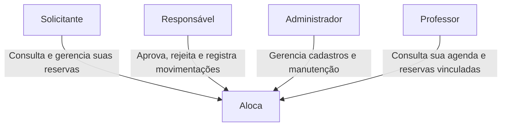
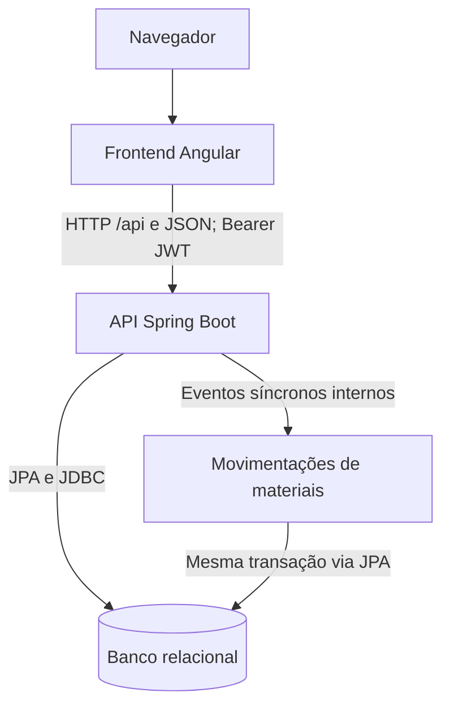
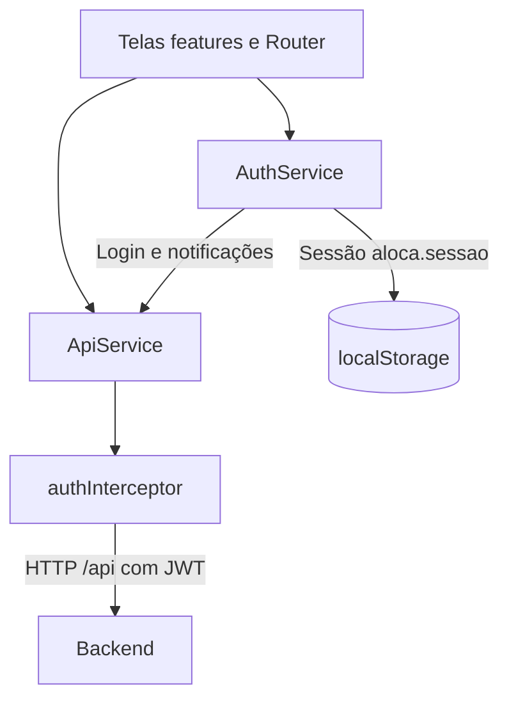
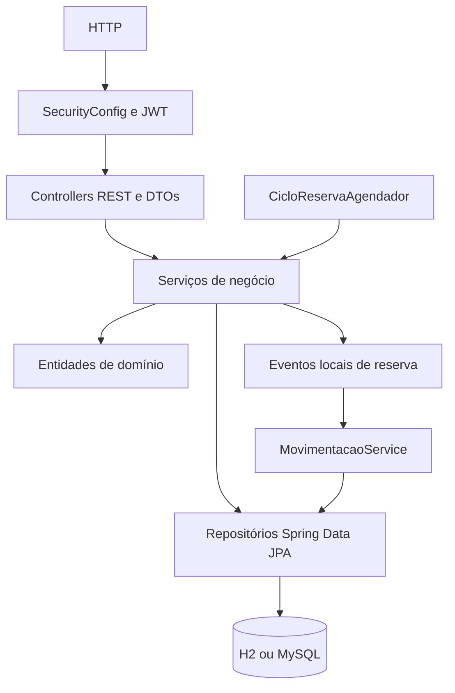
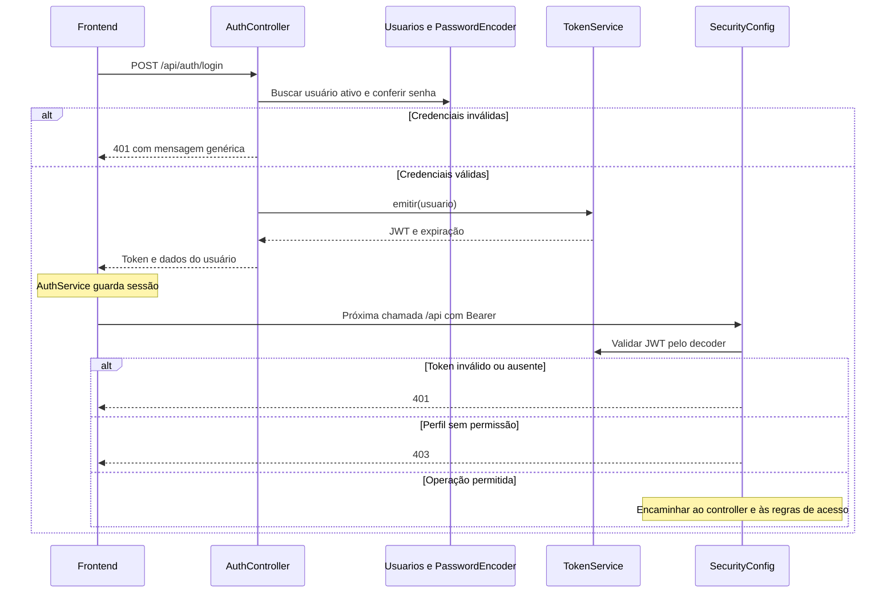
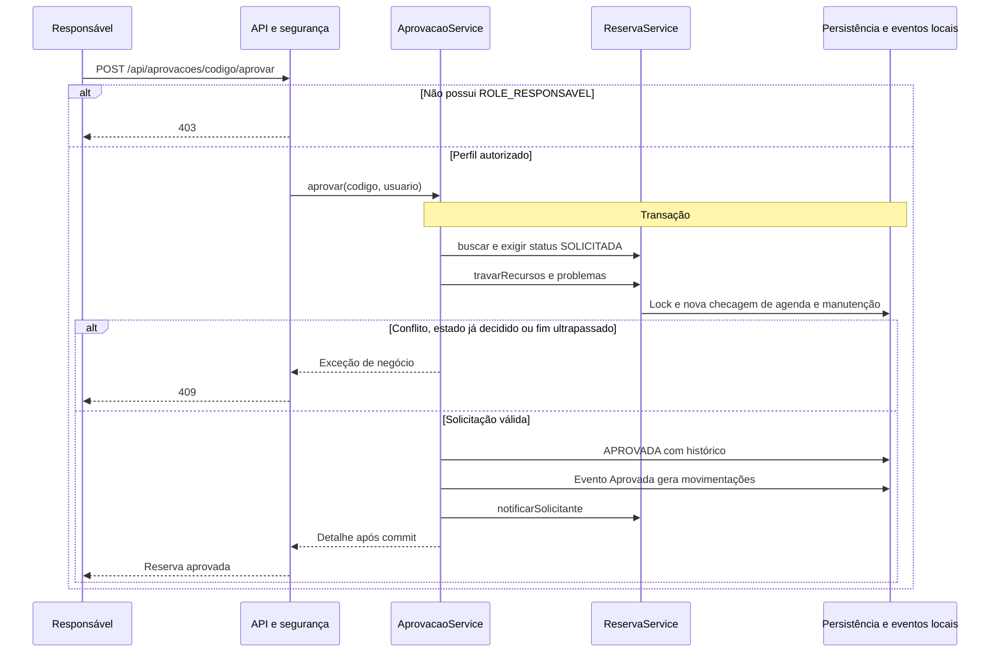
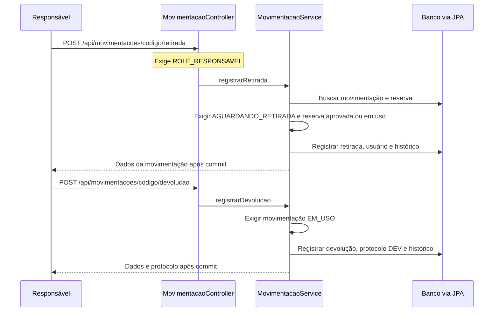
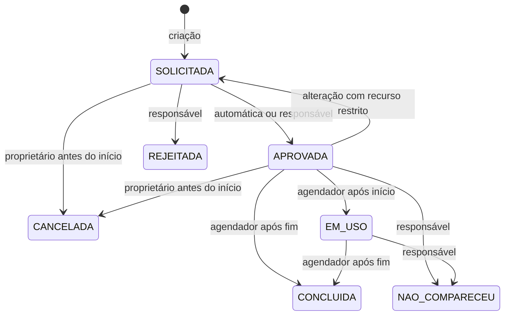

# Arquitetura do Aloca — implementação atual

Revisão: 12/11/2026. Base inspecionada: `develop`, commit `1cc881aad1ea4fdd9b093855a74eb63715658644`. Os diagramas descrevem o código desse snapshot; alterações posteriores exigem nova revisão. A `main` ainda não reúne esta implementação integrada.

Esta documentação atende ao entregável de contexto, componentes e sequências críticas. Não certifica os demais requisitos nem substitui resultados de testes. A proposta anterior permanece em [arquitetura-historica.md](arquitetura-historica.md), apenas como histórico: batch de treinamento, registry de modelos, watermark e promoção de modelos não têm implementação neste snapshot.

## 1. Contexto

O Aloca organiza salas, professores e materiais. Os quatro perfis abaixo existem no código; Professor é um perfil adicional aos três obrigatórios do enunciado. As permissões efetivas são verificadas na API.



Não há provedor externo de identidade ou serviço externo de mensagens nesse fluxo. As notificações são simuladas e persistidas internamente por `NotificacaoService`.

## 2. Contêineres e execução



Movimentações é um módulo da mesma aplicação Java, não outro processo. O frontend roda em 4200 e a API em 8080 no desenvolvimento; `proxy.conf.json` encaminha `/api`. A topologia de produção não está definida.

| Elemento | Implementação e configuração |
|---|---|
| Frontend | Angular, `src/app`; rotas em `app.routes.ts` |
| API | Java 21; Spring Boot **4.1.2**, conforme `backend/pom.xml` |
| Banco padrão | H2 em arquivo, `jdbc:h2:file:./data/aloca` |
| Perfil alternativo | MySQL, `application-mysql.properties` e `backend/docker-compose.yml` |
| Integração em testes | MySQL em Testcontainers |
| Isolamento | `TRANSACTION_READ_COMMITTED`, configurado no datasource |
| Agendamento | `CicloReservaAgendador`, ao iniciar e a cada minuto por padrão |

**Diferença em relação ao enunciado:** a especificação pede Spring Boot 3.x; o código está em 4.1.2. O diagrama registra a versão real, sem declarar conformidade nesse ponto.

## 3. Componentes

### Frontend



`AuthService` mantém usuário e token em signals e localStorage. O interceptor inclui Bearer nas chamadas de API e, em 401 fora do login, limpa a sessão e redireciona. `ConflitoStore` apoia a apresentação do conflito. O guard `exigirPerfil` está aplicado à rota de administração; não há guard declarado em todas as outras rotas. A segurança não depende do bloqueio visual de telas.

### Backend



| Componente real | Responsabilidade |
|---|---|
| `AuthController`, `TokenService`, `UsuarioAtual` | Validar credenciais, emitir JWT e resolver usuário |
| `SecurityConfig` e `@PreAuthorize` | Autorizar URLs e operações por perfil |
| `ReservaController / ReservaService` | Criar, alterar, cancelar, conferir acesso, conflitos e ciclo |
| `AprovacaoController / AprovacaoService` | Decidir solicitações restritas |
| `AdminController / AdminService` | Cadastros, usuários e bloqueios |
| `DisponibilidadeService` | Consultas de disponibilidade |
| `MovimentacaoService` | Movimentações e ouvintes de `ReservaEventos` |
| `NotificacaoService` | Notificações simuladas persistidas |
| `PainelService / RelatorioService` | Agenda, indicadores e relatórios |
| `Reserva.mudarStatus` | Mudança de estado com `HistoricoReserva` |
| `TratadorErros` | Tradução de exceções em respostas de API |

As entidades são persistidas pelos repositórios; não existe fila externa nem arquitetura de microsserviços. Os eventos de reserva usam `ApplicationEventPublisher` e ouvintes `@EventListener` síncronos, dentro da transação da operação.

## 4. Sequência — autenticação e autorização



A claim `perfis` vira autoridades `ROLE_*`. Somente Responsável acessa aprovações e movimentações; Administrador acessa administração. A checagem de proprietário da reserva fica também em `ReservaService`. O console H2 é liberado na configuração de desenvolvimento; o perfil MySQL o desabilita.

## 5. Sequência — criação, conflito e manutenção

```mermaid
sequenceDiagram
  participant F as Frontend
  participant C as ReservaController
  participant S as ReservaService
  participant DB as Repositórios e banco
  participant E as Ouvintes de eventos
  F->>C: POST /api/reservas com JWT e dados
  Note over C: Segurança por perfil e validação do DTO
  C->>S: criar(pedido, usuario)
  Note over S,DB: Início da transação
  S->>S: Validar término, data e materiais duplicados
  S->>DB: Travar recursos por id e professor
  DB-->>S: Linhas com PESSIMISTIC_WRITE
  S->>S: Validar tipos, ativos e horário de funcionamento
  S->>DB: Consultar bloqueios e reservas sobrepostas
  alt Conflito ou manutenção no período
    S->>DB: Registrar conflitos evitados
    S-->>C: EmConflito com alternativas
    Note over S,DB: Commit dos registros de conflito; sem nova reserva
    C-->>F: 409 com conflitos e até 3 alternativas
  else Período disponível
    S->>DB: Salvar reserva SOLICITADA e histórico
    alt Sala ou material restrito
      S->>DB: Notificar responsável e solicitante
    else Recursos sem restrição
      S->>S: mudarStatus(APROVADA) com histórico
      S->>E: ReservaEventos.Aprovada
      E->>DB: Gerar movimentações de materiais
      S->>DB: Notificar solicitante e registrar histórico
    end
    S-->>C: Gravada com detalhe
    Note over S,DB: Commit antes do retorno ao controller
    C-->>F: 201
  end
```

Sobreposição: `existente.inicio < pedido.fim && existente.fim > pedido.inicio`, na mesma data e compartilhando espaço, material ou professor. `SOLICITADA`, `APROVADA` e `EM_USO` ocupam agenda; intervalos consecutivos são permitidos. Erros de validação/recursos inválidos interrompem a operação; manutenção encontrada na consulta de bloqueios produz conflito.

## 6. Sequência — duas solicitações simultâneas

```mermaid
sequenceDiagram
  participant A as Transação A
  participant B as Transação B
  participant DB as MySQL
  A->>DB: Lock de recursos comuns
  DB-->>A: Lock adquirido
  B->>DB: Solicitar lock dos mesmos recursos
  Note over B,DB: B aguarda A finalizar
  A->>DB: Consultar conflitos e inserir reserva
  A->>DB: Commit
  DB-->>B: Lock liberado e adquirido por B
  B->>DB: Consultar conflitos em READ COMMITTED
  DB-->>B: Reserva de A visível
  B->>DB: Registrar conflito evitado e commit
  Note over A,B: A retorna Gravada; B retorna EmConflito
```

`RecursoRepositorio.travar` ordena ids e usa `PESSIMISTIC_WRITE`; `ProfessorRepositorio.travar` protege a agenda do docente. As travas duram até o fim da transação. `Reserva` também possui `@Version`; ele não substitui as travas dos recursos.

O diagrama descreve o caminho esperado quando A adquire o lock primeiro. `ConcorrenciaReservaTest` dispara duas chamadas ao serviço com `CyclicBarrier`, sala e projetor comuns, e exige uma única `Gravada`, repetindo cinco vezes. Isso não é um teste de carga HTTP nem comprova sozinho todas as combinações de recursos, manutenção concorrente ou implantação distribuída.

## 7. Sequência — aprovação restrita



Rejeição também exige solicitação pendente e registra motivo, histórico e notificação. Administrador sem o perfil Responsável não aprova. Uma solicitação pendente já ocupa agenda desde sua criação.

## 8. Sequência — retirada e devolução



Falha nas pré-condições gera conflito. O estado visual `DEVOLUCAO_PENDENTE` é calculado quando um material em uso ultrapassa a previsão. A devolução do material e o encerramento temporal da reserva são operações distintas.

## 9. Sequência — alteração e cancelamento com auditoria

```mermaid
sequenceDiagram
  participant F as Solicitante
  participant C as ReservaController
  participant S as ReservaService
  participant M as MovimentacaoService
  participant DB as Banco via JPA
  F->>C: PUT reserva ou POST cancelamento
  C->>S: alterar ou cancelar
  S->>DB: Buscar reserva
  S->>S: Exigir proprietário, estado gerenciável e início futuro
  S->>M: Evento AntesDeModificar
  M->>DB: Consultar materiais em uso
  alt Acesso ou alteração não permitidos
    S-->>C: Erro de negócio ou veto do ouvinte
    C-->>F: 403 ou 409
  else Alteração
    S->>DB: Travar seleção nova e verificar conflitos
    Note over S: Conflito retorna 409 sem alterar reserva
    S->>DB: Atualizar dados e histórico; restrita volta a SOLICITADA
    S->>M: Evento Alterada
    M->>DB: Cancelar pendentes e regenerar se aprovada
    S->>DB: Notificação e commit
  else Cancelamento
    S->>DB: CANCELADA e histórico
    S->>M: Evento Cancelada
    M->>DB: Cancelar movimentações pendentes
    S->>DB: Notificação e commit
  end
```

Não há endpoint DELETE de reserva em `ReservaController`. A reserva cancelada permanece no banco. O histórico integra a entidade com cascade e registra ator, instante e estados anterior/novo.

## 10. Estados reais e agendamento



O agendador chama `atualizarCiclo` ao iniciar e com intervalo padrão de um minuto. Se executar após o fim, uma reserva aprovada pode passar diretamente a concluída. Não comparecimento exige motivo, janela de 15 minutos após início até antes do fim e ausência de material retirado. Cada transição chama `mudarStatus` para registrar histórico. Este é o comportamento dos serviços; a entidade não implementa uma máquina de estados central com todas as transições validadas.

## 11. Rastreabilidade para código e testes existentes

Os números abaixo seguem o enunciado fornecido para esta revisão; documentos antigos podem ter numeração diferente. A tabela aponta evidências disponíveis no código, não resultados de execução nesta revisão.

| Regra / requisito | Fonte no backend | Teste existente a consultar |
|---|---|---|
| 1 — Autenticação e perfil | `seguranca/SecurityConfig.java`, `api/AuthController.java` | `AutenticacaoTest.java` |
| 4–6 — Reserva, sobreposição e concorrência | `servico/ReservaService.java`, repositórios de recursos/professor/reserva | `ReservaApiTest.java`, `ConcorrenciaReservaTest.java` |
| 7 — Aprovação restrita | `servico/AprovacaoService.java` | `AprovacaoApiTest.java` |
| 8 — Manutenção | `servico/AdminService.java`, `ReservaService.colisoes` | `AdminRecursosTest.java`, `QualidadeFuncionalApiTest.java` |
| 9 — Materiais | `servico/MovimentacaoService.java` | `MaterialApiTest.java` |
| 10 — Histórico e estados | `dominio/Reserva.java`, `servico/CicloReservaAgendador.java` | `ReservaApiTest.java`, `QualidadeFuncionalApiTest.java` |
| 11–12 — Notificações e relatórios | `servico/NotificacaoService.java`, `RelatorioService.java` | `QualidadeFuncionalApiTest.java`, `RelatorioApiTest.java` |
| Fluxos pela interface | `src/app/features`, `src/app/core` | `bdd/features/integracao.feature`, specs do frontend |

Todos os caminhos backend da tabela são relativos a `backend/src/main/java/br/com/aloca`; testes Java ficam em `backend/src/test/java/br/com/aloca`.

## 12. Decisões e limites desta revisão

- [ADR-0005 — Arquitetura implementada](adr/ADR-0005-arquitetura-implementada.md) registra tecnologias, transações, eventos e diferenças em relação às propostas anteriores.
- Diagramas não comprovam cobertura, ausência de vulnerabilidades, tempo de resposta ou êxito do pipeline. Essas conclusões exigem relatórios da execução correspondente.
- O escopo desta mudança é documentação; não migra Spring Boot, amplia guards nem altera regras de negócio.
- Para atualizar: identificar o commit, conferir rotas, serviços e configuração; revisar sequências e tabela de evidências; renderizar os blocos Mermaid e registrar as diferenças no PR.
